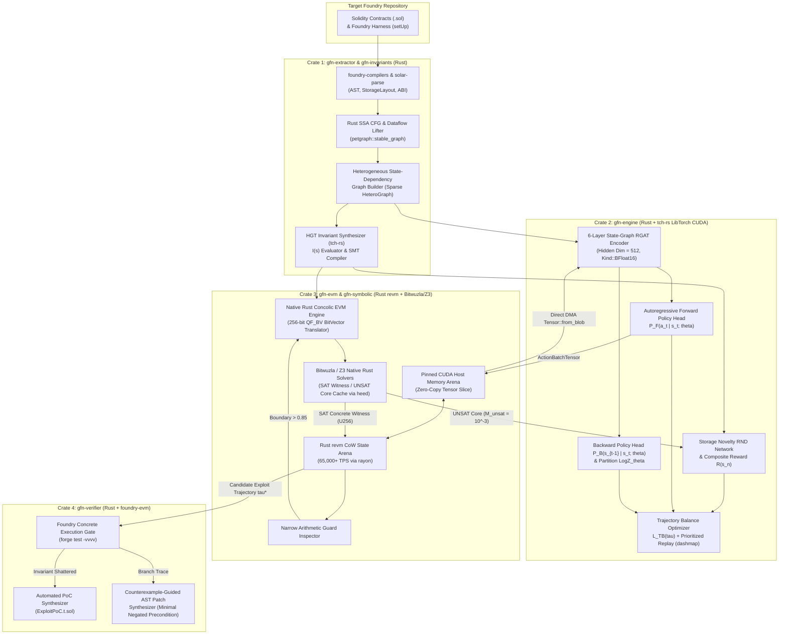
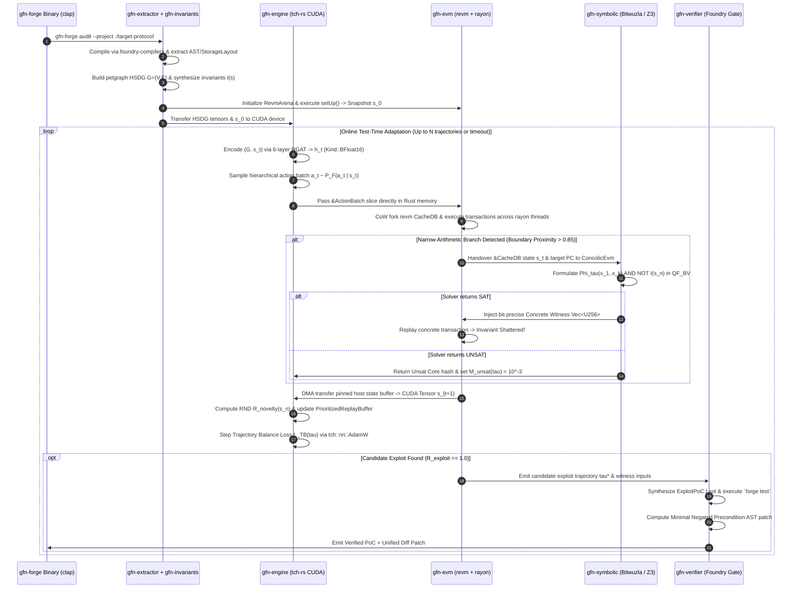

# System Architecture Specification: GFlowNet-Prover (Pure Rust / Foundry Edition)

## 1. Executive Summary & Machine Learning Formulation

### 1.1 Business Objectives to Machine Learning Formulation
Traditional smart contract security tools suffer from a fundamental dichotomy: static analyzers and Large Language Model (LLM) auditors generate 30%–70% false positives due to syntax-only heuristics and hallucinated execution states, while dynamic fuzzers (e.g., Foundry `forge test`) and standalone symbolic execution engines either stall on narrow arithmetic branch guards or collapse under exponential state-space explosion beyond 2–3 transaction steps. Furthermore, hybrid Python-Rust architectures introduce FFI serialization overhead, Global Interpreter Lock (GIL) contention, and dual-runtime deployment complexity.

**GFlowNet-Prover (Pure Rust / Foundry Edition)** unifies the entire neuro-symbolic pipeline into a **100% Native Rust Workspace (Edition 2021, `rustc 1.82.0`)**, eliminating Python/PyO3 FFI bridges entirely. It reformulates multi-contract vulnerability discovery as a **Neuro-Symbolic Generative Flow Network (GFlowNet) Trajectory Sampling and Formal Verification Problem** over a Directed Acyclic Graph (DAG) of Ethereum Virtual Machine (EVM) state transitions:
- **Generative Objective**: Learn a stochastic forward policy $P_F(a_t \mid s_t; \theta)$ parameterized by a native Rust Relational Graph Attention Network (RGAT via `tch-rs` / `libtorch` CUDA kernels) that constructs multi-step transaction trajectories $\tau = (s_0 \xrightarrow{a_1} s_1 \xrightarrow{a_2} \dots \xrightarrow{a_n} s_n)$ with probability strictly proportional to a composite neuro-symbolic reward function:
  $$P(\tau) \propto R(\tau) = R(s_n) = \left( \alpha \cdot R_{\text{boundary}}(s_n) + \beta \cdot R_{\text{novelty}}(s_n) + \gamma \cdot R_{\text{exploit}}(s_n) \right) \times M_{\text{unsat}}(\tau)$$
- **Formal Verification Gate**: Couple macro-step neural action planning directly in process memory with Rust `revm` execution and micro-step Symbolic Execution (native Rust concolic EVM + `bitwuzla-sys`/`z3` over 256-bit BitVectors `QF_BV`) to solve narrow arithmetic constraints, and enforce concrete replay inside Foundry (`foundry-evm` and `forge test`) to guarantee a **0.0% False Positive Rate**.

### 1.2 Primary Performance Metrics, Secondary Operational Metrics & Acceptance Criteria

| Metric Category | Metric Identifier | Mathematical / Operational Definition | Target Acceptance Threshold |
| :--- | :--- | :--- | :--- |
| **Primary ML Metric** | **False Positive Rate (FPR)** | $\frac{\text{Unreproducible Reported Exploits}}{\text{Total Reported Exploits}}$ verified via `forge test` concrete execution. | **$= 0.0\%$** (Hard mathematical invariant) |
| **Primary ML Metric** | **Multi-Modal Exploit Mode Coverage ($\text{Modes}@K$)** | Fraction of distinct ground-truth exploit root-causes discovered within $K=1000$ sampled trajectories on multi-bug benchmark suites (DeFiHackLabs / DamnVulnerableDeFi). | **$\ge 85.0\%$** within $K=1000$ trajectories |
| **Primary ML Metric** | **Deep Sequence Discovery Recall ($\text{Recall}@d \ge 5$)** | Recall on vulnerabilities requiring $5 \le n \le 15$ sequential state-mutating transactions. | **$\ge 75.0\%$** across held-out zero-day benchmarks |
| **Primary ML Metric** | **Spearman Flow-Reward Correlation ($\rho_{TB}$)** | Spearman rank correlation between empirical trajectory log-sampling probabilities $\log P_F(\tau)$ and log-rewards $\log R(\tau)$ on held-out protocol graphs. | **$\ge 0.82$** |
| **Secondary Operational** | **In-Memory EVM Throughput** | Macro-step concrete state transitions per second via native Rust `revm` CoW state forking per CPU worker thread (zero FFI overhead). | **$\ge 65,000\text{ TPS / thread}$** |
| **Secondary Operational** | **GFlowNet Policy Inference Latency ($p_{99}$)** | Forward pass latency of `tch::nn` RGAT + Autoregressive Policy Head for batch size $B=64$ trajectories in `Kind::BFloat16`. | **$\le 9.5\text{ ms}$** on 1x NVIDIA A100/L40S GPU |
| **Secondary Operational** | **SMT Solver Micro-Step Latency ($p_{95}$)** | Native `bitwuzla`/`z3` C-API solving time for symbolic branch conditions with hard cutoffs. | **$\le 2,200\text{ ms}$** ($p_{99}$ hard timeout at $5,000\text{ ms}$) |
| **Secondary Operational** | **End-to-End Audit Wall-Clock Time** | Total time to execute Phase 3 Online Adaptation (100,000 trajectories) + PoC synthesis on a 15-contract protocol. | **$\le 12.0\text{ minutes}$** |

### 1.3 System Constraints Audit
1. **Data Modalities**:
   - *Static Graph Modality*: Solidity Abstract Syntax Trees (`foundry-compilers` / `--ast-compact-json`), Control Flow Graphs (lifted via `solar-parse` & EVM bytecode CFG recovery), EVM Storage Layouts (`forge inspect storageLayout`), and Contract ABIs/Deployed Bytecode (`alloy-json-abi`).
   - *Dynamic Tensor Modality*: 256-bit EVM storage slot values (`alloy_primitives::U256`, `I256`, `Address`, `B256`), actor ERC20/ETH balances, and block environment variables (`block.timestamp`, `block.number`, `block.basefee`).
   - *Symbolic Modality*: SMT-LIBv2 `QF_BV` (Quantifier-Free Fixed-Size BitVectors of width 256) and `QF_ABV` (Arrays of BitVectors for EVM memory/storage mappings).
2. **Historical Volume & Class Balance**:
   - Phase 1 Pre-training corpus: 52,400 verified multi-contract repositories across Ethereum Mainnet, Arbitrum One, and Optimism ($\approx 1.8 \times 10^7$ AST nodes, $\approx 420\text{ GB}$ compressed `heed`/LMDB and `rkyv` zero-copy archives).
   - Phase 2 Bug-Discovery corpus: 680 curated real-world exploits (DeFiHackLabs, Solodit, DamnVulnerableDeFi, Ethernaut) augmented 20x via the Rust Synthetic AST Mutation Engine ($13,600$ vulnerable protocol variants).
   - Extreme state-space class imbalance: Valid exploit trajectories represent $< 10^{-8}$ of random walk trajectories of length $n=10$, necessitating GFlowNet Trajectory Balance with dense RND novelty ($R_{\text{novelty}}$) and boundary proximity ($R_{\text{boundary}}$) shaping.
3. **Compute, Memory & Compliance Constraints**:
   - *Training Hardware*: 4x NVIDIA A100 (80GB VRAM) or H100 GPUs, 64-core AMD EPYC CPU, 512GB DDR5 RAM, NVMe Gen4 SSD ($\ge 4\text{ GB/s}$ sequential read).
   - *Audit / Inference Hardware*: Single node with 1x NVIDIA L40S (48GB VRAM) or RTX 4090 (24GB VRAM), 16-core CPU, 64GB RAM.
   - *Compliance & Determinism*: Zero external RPC dependencies during online search (all state must be self-contained in local `revm` snapshots or pinned historical block forks); 100% deterministic PoC replay via pinned `solc` versions and Foundry `vm.roll`/`vm.warp` cheatcodes.

### 1.4 Machine Learning Paradigm Classification
GFlowNet-Prover is a **Pure Rust Hybrid Neuro-Symbolic Generative Flow Network (GFlowNet) and Heterogeneous Graph Representation Learning System**, combining:
1. **Geometric Deep Learning in Rust (`tch-rs` + `petgraph`)**: Heterogeneous Graph Transformer (for static invariant synthesis) and 6-layer Relational Graph Attention Network (RGAT, hidden dim $d=512$) implemented over CSR/COO sparse edge-index tensors in `tch::Tensor`.
2. **Generative Flow Networks (GFlowNets)**: Off-policy Trajectory Balance ($\mathcal{L}_{TB}$) training with autoregressive hierarchical action heads and Random Network Distillation (RND) intrinsic curiosity.
3. **Formal Methods & Concolic Execution**: High-speed concrete state exploration (`revm`) dynamically interleaved in-memory with a Rust Symbolic EVM (`gfn-symbolic`) and BitVector SMT solving (`bitwuzla`, `z3`) plus counterexample-guided patch synthesis.

---

## 2. End-to-End System Architecture & Lifecycle Flows

### 2.1 System Architecture Diagram (Pure Rust Workspace)

### 2.2 Online Auditing & Inference Sequence Flow

---

## 3. Comprehensive Pure-Rust Technology Stack & Justifications

Every crate and native C++/CUDA dependency version is strictly pinned in `Cargo.toml` (`resolver = "2"`, `edition = "2021"`, `rustc = "1.82.0"`).

| Subsystem Layer | Rust Crate / Library | Exact Version | Technical Justification & Role |
| :--- | :--- | :--- | :--- |
| **Smart Contract Compilation** | `foundry-compilers` + `svm-rs` | `0.11.0` / `0.5.12` | Programmatic Rust orchestration of `solc` (`0.8.0–0.8.28`), AST extraction (`--ast-compact-json`), and `storageLayout` inspection without spawning external shell scripts. |
| **Solidity AST & Parser** | `solar-parse` + `solar-ast` | `0.1.2` | High-speed native Rust Solidity parser (by Paradigm) for AST traversal, modifier resolution, and source-span patch synthesis. |
| **Ethereum Core Primitives** | `alloy-primitives` + `alloy-sol-types` + `alloy-dyn-abi` | `0.8.14` | Zero-overhead `U256`, `I256`, `Address`, `B256`, and dynamic ABI encoding/decoding for transaction calldata synthesis. |
| **Static Graph & CFG Topology** | `petgraph` | `0.6.5` | In-memory directed graph representation (`StableDiGraph`) for SSA Control Flow Graphs, dominator trees, and HSDG construction before sparse CSR tensor conversion. |
| **In-Memory EVM Engine** | `revm` + `revm-inspectors` | `19.0.0` / `0.12.0` | Ultra-fast Rust EVM supporting zero-allocation Copy-on-Write (`Arc<CacheDB<EmptyDB>>`) state snapshotting at $\ge 65,000\text{ TPS/thread}$. |
| **Foundry Cheatcode Runtime** | `foundry-evm` + `foundry-config` | `1.0.0` | Supplies native `vm.prank`, `vm.warp`, `vm.roll`, and `deal` cheatcode interceptors directly inside `RevmArena`. |
| **Deep Learning & CUDA Kernel Runtime** | `tch` (`libtorch` C++ bindings) | `0.18.0` (`libtorch 2.5.1+cu124`) | Direct Rust bindings to C++ LibTorch (`ATen` + cuBLAS + FlashAttention-2), enabling `Kind::BFloat16` RGAT message passing, `Kind::Float` Trajectory Balance autograd, and zero-overhead multi-GPU training. |
| **SafeTensors Serialization** | `safetensors` + `rkyv` | `0.4.5` / `0.8.8` | Zero-copy memory-mapped serialization of neural network weights (`.safetensors`) and pre-extracted HSDG dataset shards (`rkyv`). |
| **Parallelism & Async Runtime** | `rayon` + `tokio` + `crossbeam` | `1.10.0` / `1.41.1` / `0.8.4` | `rayon` drives data-parallel `revm` rollouts and SMT solver threads; `tokio` drives the `axum` REST/SSE microservice and non-blocking I/O. |
| **Primary SMT Solver** | `bitwuzla-sys` (safe wrapper in `gfn-symbolic`) | `0.6.0` | Native Rust C-FFI bindings to Bitwuzla 0.6.0 for Quantifier-Free 256-bit BitVectors (`QF_BV`) and Arrays (`QF_ABV`). |
| **Secondary SMT Solver** | `z3` + `z3-sys` | `0.12.1` (`Z3 4.13.3`) | Portfolio fallback solver and Unsat Core (`Solver::get_unsat_core()`) extractor for hybrid arithmetic constraints. |
| **High-Speed State & Unsat Cache** | `heed` (LMDB) + `xxhash-rust` + `dashmap` | `0.20.5` / `0.8.12` / `6.1.0` | Concurrent lock-free L1 cache (`DashMap`) and memory-mapped L2 persistence (`heed` LMDB) keyed by `xxh3_128` structural hashes. |
| **Web Server, CLI & Telemetry** | `axum` + `clap` + `metrics-exporter-prometheus` + `tracing` | `0.7.9` / `4.5.21` / `0.16.0` / `0.1.40` | Type-safe HTTP/SSE server (`axum`), ergonomic CLI (`clap` derive), structured JSON logging, and Prometheus `:9090/metrics` exposition. |

---

## 4. Zero-Copy Host-to-GPU Memory Architecture (`gfn-evm` $\leftrightarrow$ `gfn-engine`)

Because the entire system runs inside a single compiled Rust binary, there is **zero Python/PyO3 FFI boundary, zero serialization overhead, and zero GIL contention**:

1. **Page-Locked (Pinned) CUDA Host Memory Arena**:
   - At startup, `RevmArena` allocates a contiguous page-locked host buffer via `cudaHostAlloc` (wrapped safely in `PinnedStateBuffer` in `crates/gfn-evm/src/arena.rs`) with layout:
     - `storage_words`: `[B, N_slots, 4]` of `u64` (representing 256-bit big-endian EVM words).
     - `storage_features`: `[B, N_slots, 32]` of `f32` (pre-computed fixed-point $\log_2$ magnitude and sinusoidal byte chunk features).
     - `branch_telemetry`: `[B, N_cond, 8]` of `f32` (branch hit counts, $d_{\text{branch}}$, and SMT status flags).
2. **SIMD Feature Computation in Rust Worker Threads**:
   - As each `rayon` worker thread finishes executing transaction $a_t^{(b)}$ in `revm`, it computes the dynamic node features $\phi_{\text{mag}}(v)$ directly in CPU L1 cache using `std::simd` (`f32x8`) and writes them into slice `b` of `PinnedStateBuffer`.
3. **Asynchronous DMA Transfer (`non_blocking = true`)**:
   - `gfn-engine` wraps the pinned host slice via `tch::Tensor::from_slice` and issues a single asynchronous PCIe DMA transfer `tensor.to_device_(tch::Device::Cuda(0), Kind::BFloat16, /*non_blocking=*/true, /*copy=*/false)` into the GPU's `HeteroGraphBatch` storage buffer.

---

## 5. Hardware Resource Allocations & Topology

### 5.1 Offline Pre-Training & Curriculum Training Cluster (Phases 1 & 2)
- **GPU Allocation**: 4x NVIDIA A100-SXM4-80GB (connected via NVLink, synchronized via `nccl-sys` all-reduce in `gfn-engine`).
  - VRAM Budget per GPU:
    - Model weights, gradients, and AdamW states (`tch::nn::VarStore` in FP32 master + BF16 forward): `5.8 GB`
    - Batched Sparse `HeteroGraphBatch` tensors ($B=64$, up to 8,192 nodes/graph in `Kind::BFloat16`): `26.0 GB`
    - Prioritized Trajectory Replay Buffer (pinned device tensors): `16.0 GB`
    - CUDA cuBLAS & custom scatter-attention workspace: `10.0 GB`
    - Safety Headroom: `22.2 GB` (Total: `80.0 GB`)
- **CPU & System RAM Allocation**: 64 physical cores (128 vCPUs), 512 GB DDR5 RAM:
  - 48 cores dedicated to `gfn-evm` `rayon::ThreadPool` instances (12 cores per GPU worker).
  - 12 cores dedicated to parallel `bitwuzla`/`z3` solver threads.
  - 4 cores reserved for `tokio` async I/O, `heed` LMDB flushes, and telemetry.

### 5.2 Online Auditing Appliance / Workstation (Phase 3 & CLI Serving)
- **GPU Allocation**: 1x NVIDIA L40S (48GB VRAM) or NVIDIA RTX 4090 (24GB VRAM).
  - VRAM Budget (24GB target):
    - RGAT + Policy Heads + RND Networks (`Kind::BFloat16`): `2.4 GB`
    - Active Target Protocol HSDG & Batched Trajectories ($B=64$, length $T=15$): `8.8 GB`
    - Online Adaptation Replay Buffer (8,192 trajectories): `4.0 GB`
    - Safety Headroom: `8.8 GB`
- **CPU Allocation**: 16 physical cores (8 cores for `revm` CoW simulation, 6 cores for concurrent Bitwuzla/Z3 SMT worker threads, 2 cores for `tokio` runtime and `forge test` verification).
- **Memory & Disk**: 64 GB RAM (16 GB allocated to tmpfs `/dev/shm` for zero-disk-I/O Foundry PoC compilation and LMDB Unsat Core caching).

---

## 6. Failure Modes, Exception Handling & Resilience Architecture

All fallible operations in the Rust workspace return explicit `Result<T, GfnError>` types (`thiserror = "2.0.3"`). Unchecked `.unwrap()` or `.expect()` calls are denied at compile time via `#![deny(clippy::unwrap_used, clippy::expect_used)]` across all production crates.

| Failure Domain | Trigger Condition | Detection Mechanism | Deterministic Fallback & Recovery Action |
| :--- | :--- | :--- | :--- |
| **Foundry Compilation Failure** | Target repository uses incompatible `solc` pragma or missing git submodules. | `foundry_compilers::Project::compile()` returns `SolcError` or missing `storageLayout` artifacts. | Return `Err(GfnError::CompilationArtifact { .. })`; automatically inspect `foundry.toml` & pragma headers, invoke `svm_rs::install(version)`, run `git submodule update --init --recursive`, and retry once before aborting with structured JSON diagnostics. |
| **Storage Layout Ambiguity** | Unstructured proxy storage (EIP-1967 / Diamond EIP-2535) or inline assembly `sstore(slot, val)` bypassing standard layout. | Bytecode CFG analyzer detects `SSTORE`/`SLOAD` with dynamic slot computation not present in static `StorageLayout`. | Dynamically inject a `SyntheticDynamicStorageNode` into the `petgraph` HSDG indexed by the symbolic `keccak256` slot expression, tracked at runtime via `revm::Inspector::step` hooks on `SSTORE` (`0x55`) and `SLOAD` (`0x54`). |
| **GPU Out-Of-Memory (OOM)** | Target repository contains $> 25,000$ AST/CFG nodes, exceeding VRAM during $B=64$ rollout. | `tch::TchError::CudaOutOfMemory` caught via `Tensor::f_...` fallible API in `RolloutWorker`. | Drop intermediate tensors, invoke `tch::Cuda::empty_cache()`, dynamically halve batch size ($B \leftarrow \max(8, B / 2)$), enable activation recomputation on RGAT layers 1–6, and apply 2-hop ego-graph subgraph pruning around active `StorageNode`s. |
| **SMT Solver Timeout / Path Explosion** | Non-linear Keccak256 pre-images or deeply nested loop unrolling in `gfn-symbolic` exceeds solver budget. | Bitwuzla `Terminator` callback triggers when `Instant::now().duration_since(start) >= timeout_ms`. | Abort solver cleanly via `bitwuzla_terminate` hook, record branch hash as `SmtStatus::Unknown` (set $M_{\text{unsat}}(\tau) = 0.5$ rather than $10^{-3}$), concretize symbolic environment variables to current `revm` snapshot values, and fall back to GFlowNet stochastic boundary sampling. |
| **EVM / Solver Panic Guard** | Malformed EVM bytecode or pathological solver state triggers an internal panic. | `std::panic::catch_unwind` boundary around each `rayon` task in `RevmArena::step_batch` and `PortfolioSmtSolver::solve`. | Convert panic payload into `Err(GfnError::WorkerPanicked { env_idx, msg })`; reset the specific corrupted environment slot `env_idx` in `RevmArena` back to $s_0$ without terminating the audit process. |
