# Operational Monitoring & Maintenance Specification: GFlowNet-Prover (Pure Rust / Foundry Edition)

## 1. Data Drift & Structural Topology Drift Detection

Smart contract ecosystems evolve rapidly (new `solc` compiler opcodes such as `TSTORE`/`TLOAD` in EIP-1153 Cancun, new DeFi standards such as Uniswap v4 Singleton Hooks, and ERC-7579 modular accounts). Data drift in GFlowNet-Prover manifests as **Graph Structural & Opcode Distribution Shift** between the Phase 1/2 training corpus and incoming target repositories, monitored natively in `crates/gfn-monitor/src/drift.rs`.

### 1.1 Quantitative Data Drift Metrics (Evaluated per 100 Audited Repositories)

| Drift Dimension | Monitored Feature / Distribution | Statistical Distance Test | Warning Threshold | Critical Retraining Trigger |
| :--- | :--- | :--- | :--- | :--- |
| **HSDG Node/Edge Degree Distribution** | Joint distribution of (`StorageNode`, `FunctionNode`, `ConditionNode`, `ExternalCallNode`) counts and `ReadsFrom`/`WritesTo` in/out-degrees in `petgraph`. | **Maximum Mean Discrepancy (MMD)** with RBF kernel ($\sigma = 1.0$) over `ndarray` spectral embeddings. | $\text{MMD}^2 > 0.08$ | $\text{MMD}^2 > 0.15$ |
| **EVM & SSA Opcode Histogram** | Relative frequency of 84 EVM/SSA opcodes (specifically tracking `TLOAD`/`TSTORE`, `DELEGATECALL`, `CREATE2`, `CUSTOM_ERROR`). | **Population Stability Index (PSI)** across 20 quantile/categorical bins. | $\text{PSI} > 0.15$ | $\text{PSI} > 0.25$ |
| **Storage Slot Type & Packing Shift** | Proportion of packed variables (`byte_size < 32`), nested mappings, and assembly `SSTORE` slots. | **Jensen-Shannon Divergence ($D_{JS}$)** against Phase 1 reference distribution. | $D_{JS} > 0.10$ | $D_{JS} > 0.20$ |
| **Random Network Distillation (RND) Baseline Saturation** | Initial step-0 RND prediction error $\| \hat{f}_{\text{pred}}(s_0) - f_{\text{target}}(s_0) \|_2^2$ prior to online adaptation. | **Two-Sample Kolmogorov-Smirnov (KS) Test** ($\alpha = 0.01$). | $D_{KS} > 0.18$ | $D_{KS} > 0.30$ |

---

## 2. Concept Drift & Neuro-Symbolic Alignment Monitoring

Concept drift occurs when the relationship between static/dynamic graph representations and actual exploitability shifts—for example, when novel economic primitives violate safety properties not covered by the 4 canonical invariant categories, or when the GFlowNet forward policy $P_F(\tau)$ fails to track the true reward landscape $R(\tau)$.

### 2.1 Concept Drift Indicators & Thresholds
1. **Trajectory Balance Residual Surge ($\Delta_{TB}$ Drift)**:
   - Monitor the moving median of the Trajectory Balance residual $|\Delta_{TB}(\tau)| = |\log Z_\theta + \sum \log P_F - \log R(\tau) - \sum \log P_B|$ after 1,000 steps of Phase 3 Online Adaptation.
   - *Threshold*: If median $|\Delta_{TB}(\tau)| > 2.5$ after 1,000 adaptation updates (baseline expected $\le 0.45$), emit `TracingAlert::ConceptDriftFlowMisalignment`.
2. **Spearman Flow-Reward Rank Correlation ($\rho_{TB}$) Degradation**:
   - Compute Spearman rank correlation $\rho_{TB}$ between $\log P_F(\tau)$ and $\log R(\tau)$ across top-500 distinct trajectories per audit.
   - *Threshold*: Warning if $\rho_{TB} < 0.72$; Critical if $\rho_{TB} < 0.60$.
3. **SMT Solver Handover Efficacy Ratio (`SAT / (SAT + UNSAT + TIMEOUT)`)**:
   - Tracks whether the GFlowNet's symbolic domain trigger (`ArgDomain::SymbolicBv256Solve`) is routing feasible vs. hopelessly over-constrained branches to `gfn-symbolic` (`Bitwuzla`/`Z3`).
   - *Threshold*: If `SMT_TIMEOUT_RATE > 18.0%` or `SMT_SAT_RATE < 3.0%` over a 24-hour window, trigger `TracingAlert::SymbolicConcretizerCalibration`.
4. **Revm-to-Forge Concrete Gate Rejection Rate**:
   - Tracks any candidate trajectory where $R_{\text{exploit}}(s_n) == 1.0$ inside `crates/gfn-evm` (`RevmArena`) but fails `forge test` in `crates/gfn-verifier`.
   - *Threshold*: **Strict Zero Tolerance (`> 0.0%` triggers P1 Engineering Incident)**—indicates an EVM specification mismatch between `revm` and Foundry `forge` (e.g., gas schedule or precompile discrepancy).

---

## 3. Runtime Latency & Resource Telemetry (`metrics-exporter-prometheus`)

The `gfn-forge` binary exposes Prometheus metrics on `:9090/metrics` via `metrics = "0.24.0"` and `metrics-exporter-prometheus = "0.16.0"` scraped every `5s`:

| Metric Name | Prometheus Type | Labels | SLA Target ($p_{50}$ / $p_{95}$ / $p_{99}$) |
| :--- | :--- | :--- | :--- |
| `gfn_hsdg_extraction_duration_seconds` | `Histogram` | `solc_version`, `contract_count_bucket` | $2.8\text{ s}$ / $7.5\text{ s}$ / $16.0\text{ s}$ |
| `gfn_rgat_policy_step_latency_ms` | `Histogram` | `batch_size`, `device` | $3.6\text{ ms}$ / $6.8\text{ ms}$ / $\le 9.5\text{ ms}$ |
| `gfn_revm_batch_throughput_tps` | `Gauge` | `worker_id`, `cow_depth` | $\ge 65,000\text{ TPS/thread}$ |
| `gfn_smt_solve_duration_ms` | `Histogram` | `solver` (`bitwuzla`, `z3`), `result` (`sat`, `unsat`, `timeout`) | $120\text{ ms}$ / $2,200\text{ ms}$ / $\le 5,000\text{ ms}$ |
| `gfn_unsat_cache_hit_ratio` | `Gauge` | `cache_tier` (`l1_dashmap`, `l2_heed_lmdb`) | $\ge 0.65$ after 5,000 trajectories |
| `gfn_gpu_vram_allocated_bytes` | `Gauge` | `gpu_id`, `phase` | $\le 85\%$ of physical VRAM |

---

## 4. Prediction Confidence & Exploration Health Monitoring

Unlike standard classifiers that output a single softmax probability, GFlowNet-Prover's confidence and exploration completeness are governed by **Flow Entropy and Partition Convergence**:

1. **Action-Space Policy Entropy ($H(P_F)$)**:
   $$H(P_F(s_t)) = - \sum_{a_t} P_F(a_t \mid s_t; \theta) \log P_F(a_t \mid s_t; \theta)$$
   - *Mode-Collapse Guard*: If mean trajectory entropy $\bar{H}(P_F)$ drops below $0.35\text{ nats}$ before $20\%$ of the trajectory budget is consumed, `OnlineAdaptationController` in `crates/gfn-engine` automatically boosts softmax temperature $\tau_{\text{temp}} \leftarrow \min(2.5, 1.5 \times \tau_{\text{temp}})$ and increases RND novelty weight $\beta \leftarrow 2.0 \times \beta$.
2. **Partition Function ($\log Z_\theta$) Stationarity Criterion (Audit Stopping Confidence)**:
   - An audit is certified as having reached **High-Confidence Exploration Convergence** when the relative standard deviation of $\log Z_\theta$ over the last $5,000$ trajectories satisfies:
     $$\frac{\text{StdDev}(\log Z_{\theta, t-5000:t})}{|\text{Mean}(\log Z_{\theta, t-5000:t})| + 1.0} < 0.01 \quad \text{and} \quad \bar{R}_{\text{novelty}}(s_n) < 0.05$$

---

## 5. Automated Continuous Retraining & Curriculum Update Pipeline

When any Critical Drift Trigger (Section 1.1 or 2.1) fires, or on a scheduled bi-weekly cadence, the **Automated Continuous Curriculum Pipeline** executes via `gfn-forge train-continual` inside Argo Workflows / GitHub Actions:

```mermaid
flowchart LR
    DRIFT["Drift Detector Trigger\n(PSI > 0.25 or MMD^2 > 0.15\nor Bi-Weekly Cron)"] --> INGEST["1. Corpus Harvester\nFetch new Mainnet/L2 Verified\nContracts & DeFiHackLabs PoCs"]
    INGEST --> DEDUP["2. MinHash Deduplication\n& Temporal Split Sanitizer\n(Jaccard <= 0.70)"]
    DEDUP --> MUTATE["3. Synthetic AST Mutation Engine\nInject 20x Economic & Rounding\nVulnerabilities via solar-ast"]
    MUTATE --> PHASE1["4. Phase 1 Continual MSTM\nWarm-start RGAT on Masked\nState-Transition Prediction (5 epochs)"]
    PHASE1 --> PHASE2["5. Phase 2 Curriculum TB Training\nOptimize L_TB + Replay Buffer\nwith Elastic Weight Consolidation (EWC)"]
    PHASE2 --> GATE["6. Release Gate Verification\nRun Suites A, B, C\n(FPR == 0%, Modes@1000 >= 85%)"]
    GATE -->|"All 7 Gates Pass"| PROMOTE["7. Atomic SafeTensors Promotion\nUpdate Production Registry"]
    GATE -->|"Any Gate Fails"| ROLLBACK["Quarantine Checkpoint\n& Alert ML Lead"]
```

### 5.1 Catastrophic Forgetting Prevention via Elastic Weight Consolidation (EWC)
During continual updates on new Solidity compiler versions or DeFi archetypes, the Phase 2 Trajectory Balance loss in `crates/gfn-engine/src/tb_loss.rs` is augmented with an EWC quadratic penalty anchored to the diagonal Fisher Information Matrix $F_i$ (`tch::Tensor`) of the previous production checkpoint $\theta^*$:
$$\mathcal{L}_{\text{total}}(\theta) = \mathcal{L}_{TB}(\tau; \theta) + \frac{\lambda_{\text{EWC}}}{2} \sum_{i} F_i \left(\theta_i - \theta_i^*\right)^2, \quad \lambda_{\text{EWC}} = 400.0$$
This guarantees that learning new EVM opcodes (`TSTORE`/`TLOAD`) never degrades recall on classical reentrancy, flash-loan solvency, or ERC-4626 rounding vulnerabilities.
