# Autonomous Agent Execution Roadmap: GFlowNet-Prover (Pure Rust / Foundry Edition)
## 21-Step Context-Window-Optimized Prompt Execution Plan

---

## 1. Executive Summary & Context-Window Feasibility Analysis

### 1.1 Context Window & Generation Limit Engineering
When implementing a complex neuro-symbolic machine learning system in pure Rust (`rustc 1.82.0`), executing the codebase via an AI coding agent requires strict alignment between **large input context windows** (128k–1M+ tokens) and **finite output generation limits** (4,096 to 8,192 tokens, or ~300–800 lines of rigorous, strongly typed Rust per generation turn).

Attempting to implement this repository in high-level milestones (e.g., generating an entire crate in a single prompt) causes:
1. **Output Truncation & Halting:** Large output token demands cause LLMs to abruptly cut off mid-struct or emit skeleton code with `// TODO: implement`, violating the project's mandatory `#![deny(clippy::unwrap_used, clippy::expect_used, unsafe_op_in_unsafe_fn)]` policy.
2. **Interface & Lifetime Drift:** Rust's strict type system and borrow checker forbid partial or misaligned trait implementations. Generating interdependent modules across crates simultaneously causes signature mismatches.
3. **Compilation DAG Breakage:** Downstream crates (`gfn-engine`, `gfn-symbolic`, `gfn-verifier`) cannot compile until upstream foundational crates (`gfn-common`, `gfn-evm`, `gfn-extractor`) have fully stabilized.

### 1.2 Mathematical Formulation of the 21-Step Decomposition
To guarantee zero-defect compilation and complete implementation, the project is decomposed into **21 atomic, sequential prompt steps** across **9 logical phases**. Each step satisfies the following invariant:

$$\text{Step}(\text{Files}, \text{Tokens}) \implies \begin{cases} \text{Input Context Overhead} \le 25,000\text{ tokens (Specs + Interface Traits)} \\ \text{Generated Code Output} \in [1,500, 5,500]\text{ tokens (300–700 lines)} \\ \text{Deterministic Verification} = \texttt{cargo check} \lor \texttt{cargo test} \lor \texttt{cargo bench} = 0 \end{cases}$$

---

## 2. Compilation Dependency DAG & System Architecture

```mermaid
flowchart TD
    subgraph P0["Phase 0: Workspace Foundation"]
        S1["Step 1: Workspace Manifest & Configs"] --> S2["Step 2: gfn-common Schemas & Math"]
    end
    subgraph P1["Phase 1: In-Memory EVM Engine"]
        S2 --> S3["Step 3: gfn-evm Inspector & Cheatcodes"]
        S3 --> S4["Step 4: gfn-evm RevmArena CoW Batching"]
    end
    subgraph P2["Phase 2: Static Analysis & HSDG"]
        S4 --> S5["Step 5: gfn-extractor Compiler & CFG"]
        S5 --> S6["Step 6: gfn-extractor HSDG Builder"]
    end
    subgraph P3["Phase 3: Invariant Synthesis"]
        S6 --> S7["Step 7: gfn-invariants Templates & Compiler"]
        S7 --> S8["Step 8: gfn-invariants HGT Module"]
    end
    subgraph P4["Phase 4: Concolic EVM & SMT"]
        S8 --> S9["Step 9: gfn-symbolic Unsat Cache & Concretizer"]
        S9 --> S10["Step 10: gfn-symbolic Portfolio SMT Solver"]
    end
    subgraph P5["Phase 5: Trajectory GFlowNet Engine"]
        S10 --> S11["Step 11: gfn-engine RGAT Encoder"]
        S11 --> S12["Step 12: gfn-engine Policy Heads & LogZ"]
        S12 --> S13["Step 13: gfn-engine RND Curiosity & TB Loss"]
        S13 --> S14["Step 14: gfn-engine Replay Buffer & Rollout Worker"]
    end
    subgraph P6["Phase 6: Verification & Synthesis"]
        S14 --> S15["Step 15: gfn-verifier Turnkey PoC Synthesizer"]
        S15 --> S16["Step 16: gfn-verifier Concrete Forge Gate & Patch"]
    end
    subgraph P7["Phase 7: Monitoring & Telemetry"]
        S16 --> S17["Step 17: gfn-monitor Drift & Prometheus Telemetry"]
    end
    subgraph P8["Phase 8: Serving & CLI"]
        S17 --> S18["Step 18: gfn-cli Axum REST & SSE Microservice"]
        S18 --> S19["Step 19: gfn-cli Clap CLI Entrypoint"]
    end
    subgraph P9["Phase 9: Benchmarks & E2E Verification"]
        S19 --> S20["Step 20: Foundry Multi-Bug Test Fixtures"]
        S20 --> S21["Step 21: Full E2E & Metamorphic Integration Tests"]
    end
```

---

## 3. The 21-Step Prompt Roadmap

### Phase 0: Workspace Foundation & Core Utilities

#### Step 1: Workspace Manifests, Toolchain & Build Automation
* **Target Files:**
  * `Cargo.toml` (Root workspace)
  * `rust-toolchain.toml`
  * `Dockerfile`
  * `Makefile`
  * `configs/default_audit.toml`
  * `configs/pretrain_mstm.toml`
  * `configs/curriculum_tb.toml`
* **Token Budget:** ~18,000 input tokens | ~3,200 output tokens.
* **Prompt for AI Agent:**
  > "Initialize the root Rust workspace for GFlowNet-Prover. Create `Cargo.toml` with `resolver = '2'`, `edition = '2021'`, and declare all 8 member crates (`crates/gfn-common`, `crates/gfn-extractor`, `crates/gfn-invariants`, `crates/gfn-evm`, `crates/gfn-symbolic`, `crates/gfn-engine`, `crates/gfn-verifier`, `crates/gfn-monitor`, `crates/gfn-cli`). Pin dependencies across the workspace: `alloy-primitives = '0.8.14'`, `revm = '19.0.0'`, `foundry-compilers = '0.11.0'`, `tch = '0.18.0'`, `solar-parse = '0.1.2'`, `petgraph = '0.6.5'`, `tokio = '1.41.1'`, `axum = '0.7.9'`, `heed = '0.20.5'`, `rkyv = '0.7.44'`, and `thiserror = '2.0.3'`. Create `rust-toolchain.toml` pinning Rust `1.82.0` with `clippy` and `rustfmt`. Create the multi-stage `Dockerfile` (CUDA 12.4 + LibTorch 2.5.1 + Foundry), `Makefile` with test, bench, and clippy targets, and all three TOML files in `configs/` according to `docs/07_programming_plan/programming_plan_spec.md`."
* **Exit Criteria:** `cargo check --workspace` passes without errors.

---

#### Step 2: `gfn-common` Error Protocols, Math Utilities & Schemas
* **Target Files:**
  * `crates/gfn-common/Cargo.toml`
  * `crates/gfn-common/src/lib.rs`
  * `crates/gfn-common/src/error.rs`
  * `crates/gfn-common/src/schemas.rs`
  * `crates/gfn-common/src/math.rs`
* **Token Budget:** ~14,000 input tokens | ~3,800 output tokens.
* **Prompt for AI Agent:**
  > "Implement `crates/gfn-common` strictly adhering to `#![deny(clippy::unwrap_used, clippy::expect_used)]`. In `error.rs`, implement `GfnError` using `thiserror` covering all domain error codes (`[GFN_ERR_101]` to `[GFN_ERR_502]`) and define `pub type GfnResult<T> = Result<T, GfnError>;`. In `schemas.rs`, define strongly typed zero-copy structs using `rkyv` and `serde`: `FoundryContractArtifact`, `StorageSlotRecord`, `StorageSemanticRole`, `SoliditySlotType`, `SynthesizedInvariant`, `TrajectoryRecord`, and `VerifiedFinding`. In `math.rs`, implement exact mathematical routines: `u256_to_log2_norm`, 16-channel sinusoidal chunk positional encodings, and Spearman rank correlation $\rho$. Include comprehensive unit tests."
* **Exit Criteria:** `cargo test -p gfn-common` exits 0; 100% assertions pass.

---

### Phase 1: High-Speed In-Memory EVM Engine (`gfn-evm`)

#### Step 3: `gfn-evm` Custom Inspector & Foundry Cheatcodes
* **Target Files:**
  * `crates/gfn-evm/Cargo.toml`
  * `crates/gfn-evm/src/lib.rs`
  * `crates/gfn-evm/src/inspector.rs`
  * `crates/gfn-evm/src/cheatcodes.rs`
* **Token Budget:** ~16,000 input tokens | ~4,200 output tokens.
* **Prompt for AI Agent:**
  > "Implement the custom inspector and cheatcode runtime in `crates/gfn-evm`. In `src/inspector.rs`, implement `revm::Inspector` tracking `SLOAD` and `SSTORE` accesses, record dynamic memory writes, and calculate JUMPI (`0x57`) branch distance metrics:
  > $$d_{\text{branch}}(lhs, rhs) = 1.0 - \frac{\log_2(|lhs - rhs| + 1)}{256.0}$$
  > In `src/cheatcodes.rs`, intercept Foundry cheatcode precompiles at address `0x7109709ECfa91a80626fF3989D68f67F5b1DD12D`, implementing `vm.prank`, `vm.warp`, `vm.roll`, and `deal` using `alloy_primitives`."
* **Exit Criteria:** `cargo check -p gfn-evm`.

---

#### Step 4: `gfn-evm` RevmArena CoW Execution & Criterion Benchmark
* **Target Files:**
  * `crates/gfn-evm/src/arena.rs`
  * `crates/gfn-evm/benches/revm_tps_bench.rs`
* **Token Budget:** ~18,000 input tokens | ~4,600 output tokens.
* **Prompt for AI Agent:**
  > "Implement `RevmArena` in `crates/gfn-evm/src/arena.rs`. Support in-memory Copy-on-Write (CoW) state snapshotting over an `Arc<CacheDB<EmptyDB>>` base state $s_0$ generated from Foundry `setUp()`. Implement parallel batch execution using `rayon::ThreadPool`, handling `StepBatchInput` and returning `StepBatchOutput` (storage words, SIMD dynamic features, branch telemetry, reverted masks, and Blake3 state hashes). Implement snapshot saving (`snapshot_env`) and bit-exact state restoration (`restore_snapshot`). In `benches/revm_tps_bench.rs`, write a Criterion benchmark asserting $\ge 65,000\text{ TPS/thread}$ across 8 worker threads with $< 5\text{ MB}$ RSS memory growth."
* **Exit Criteria:** `cargo test -p gfn-evm` and `cargo bench -p gfn-evm` execute cleanly.

---

### Phase 2: Static Analysis & HSDG Builder (`gfn-extractor`)

#### Step 5: `gfn-extractor` Foundry Compiler & Solar SSA CFG Lifter
* **Target Files:**
  * `crates/gfn-extractor/Cargo.toml`
  * `crates/gfn-extractor/src/lib.rs`
  * `crates/gfn-extractor/src/compiler.rs`
  * `crates/gfn-extractor/src/cfg_lifter.rs`
  * `crates/gfn-extractor/src/proxy_resolver.rs`
* **Token Budget:** ~18,000 input tokens | ~4,800 output tokens.
* **Prompt for AI Agent:**
  > "Implement the static analysis lifters in `crates/gfn-extractor`. In `compiler.rs`, wrap `foundry-compilers` and `svm-rs` to invoke programmatic compilation requesting AST, ABI, deployed bytecode, and storage layouts. In `cfg_lifter.rs`, parse Solidity sources with `solar-parse` and lift basic blocks into a `petgraph::stable_graph::StableDiGraph`, computing dominator frontiers to extract `ReadsFrom`, `WritesTo`, `Guards`, and `Invokes` relations. In `proxy_resolver.rs`, resolve EIP-1967 and EIP-2535 Diamond storage slots to merge implementation function nodes onto proxy state slots."
* **Exit Criteria:** `cargo check -p gfn-extractor`.

---

#### Step 6: `gfn-extractor` Heterogeneous Graph Tensors (HSDG) Builder
* **Target Files:**
  * `crates/gfn-extractor/src/hsdg_builder.rs`
* **Token Budget:** ~19,000 input tokens | ~4,500 output tokens.
* **Prompt for AI Agent:**
  > "Implement `HsdgBuilder` in `crates/gfn-extractor/src/hsdg_builder.rs`. Construct `HeteroGraphTensors` with strictly typed feature matrices:
  > - `storage_x`: shape `[N_storage, 64]`, `Kind::Float` (18-slot type, 8-role, packing coordinates, and SIMD dynamic features).
  > - `function_x`: shape `[N_func, 64]`, `Kind::Float` (visibility, mutability, modifiers, complexity metrics, and 40-dim selector/opcode projection).
  > - `condition_x`: shape `[N_cond, 48]`, `Kind::Float` (guard origin, operator profile, threshold scale, and runtime telemetry).
  > - `ext_call_x`: shape `[N_ext, 32]`, `Kind::Float` (call opcode, target type, reentrancy flags).
  > Implement `update_dynamic_batch` to update runtime features at step $t$ in pinned host memory. Add unit tests asserting $100\%$ finite values."
* **Exit Criteria:** `cargo test -p gfn-extractor` passes with $\ge 92\%$ code coverage.

---

### Phase 3: Automated Invariant Synthesis (`gfn-invariants`)

#### Step 7: `gfn-invariants` Template Library & SMT Invariant Compiler
* **Target Files:**
  * `crates/gfn-invariants/Cargo.toml`
  * `crates/gfn-invariants/src/lib.rs`
  * `crates/gfn-invariants/src/templates.rs`
  * `crates/gfn-invariants/src/compiler.rs`
* **Token Budget:** ~15,000 input tokens | ~4,200 output tokens.
* **Prompt for AI Agent:**
  > "Implement invariant templates and compilation in `crates/gfn-invariants`. In `templates.rs`, implement parameterized templates for:
  > 1. Solvency: $\sum \text{shares} \times \text{price} \le \text{assets}$
  > 2. State Machine Monotonicity: valid lifecycle state ordering
  > 3. Access Control: unauthorized caller cannot modify protected state
  > 4. Precision Neutrality: zero instant round-trip arbitrage delta
  > In `compiler.rs`, compile candidate templates into: (a) vectorized closures evaluating `RevmArena` storage states, and (b) SMT-LIBv2 `QF_BV` constraint strings for formal verification."
* **Exit Criteria:** `cargo check -p gfn-invariants`.

---

#### Step 8: `gfn-invariants` Heterogeneous Graph Transformer (HGT)
* **Target Files:**
  * `crates/gfn-invariants/src/hgt.rs`
* **Token Budget:** ~18,000 input tokens | ~4,400 output tokens.
* **Prompt for AI Agent:**
  > "Implement the 4-layer Heterogeneous Graph Transformer in `crates/gfn-invariants/src/hgt.rs` using `tch::nn`. Implement `HgtConvLayer` with 8 attention heads, residual connections, and layer normalization across the 4 node types and 8 edge types. Implement `BilinearSlotMatcher` to classify candidate storage pairs and output confidence scores. Implement `HgtInvariantSynthesizer::synthesize_and_verify`, verifying that candidate invariants violated during benign `RevmArena` warm-up (1,000 steps) are filtered out with $0\%$ false invariant lock-in."
* **Exit Criteria:** `cargo test -p gfn-invariants` passes all invariant classification tests.

---

### Phase 4: Native Concolic EVM & SMT Solver Bridge (`gfn-symbolic`)

#### Step 9: `gfn-symbolic` Unsat Core Cache & Concretizer
* **Target Files:**
  * `crates/gfn-symbolic/Cargo.toml`
  * `crates/gfn-symbolic/src/lib.rs`
  * `crates/gfn-symbolic/src/unsat_cache.rs`
  * `crates/gfn-symbolic/src/concretizer.rs`
* **Token Budget:** ~16,000 input tokens | ~4,100 output tokens.
* **Prompt for AI Agent:**
  > "Implement the caching and concretization layers in `crates/gfn-symbolic`. In `unsat_cache.rs`, create a two-tier cache with an L1 in-memory `DashMap<[u8; 16], SmtResolution>` (65,536 entries, `< 0.01 ms` lookup) and an L2 persistent LMDB store via `heed` keyed by `xxh3_128` of canonicalized SMT constraints. In `concretizer.rs`, implement partial concretization of non-linear polynomial multiplication/division and `keccak256` hashing by substituting concrete runtime values from the `RevmArena` snapshot."
* **Exit Criteria:** `cargo check -p gfn-symbolic`.

---

#### Step 10: `gfn-symbolic` Concolic EVM & Bitwuzla/Z3 Portfolio Solver
* **Target Files:**
  * `crates/gfn-symbolic/src/concolic_evm.rs`
  * `crates/gfn-symbolic/src/solver.rs`
* **Token Budget:** ~20,000 input tokens | ~5,000 output tokens.
* **Prompt for AI Agent:**
  > "Implement the symbolic execution engine and solver bridge in `crates/gfn-symbolic`. In `concolic_evm.rs`, translate 256-bit EVM arithmetic opcodes into SMT-LIBv2 `QF_BV` expressions. In `solver.rs`, implement `PortfolioSmtSolver` interfacing `bitwuzla-sys` (primary, fast BV) and `z3` (fallback) in parallel using `rayon`. Enforce hard timeouts via `Terminator` callbacks ($5,000\text{ ms}$). On `SAT`, extract bit-precise concrete witness calldata (`U256`); on `UNSAT`, extract the minimal Unsat Core and update $M_{\text{unsat}} = 10^{-3}$."
* **Exit Criteria:** `cargo test -p gfn-symbolic` passes arithmetic constraint solving and verifies cache hits.

---

### Phase 5: Trajectory GFlowNet Engine (`gfn-engine`)

#### Step 11: `gfn-engine` State-Graph Relational GAT (RGAT) Encoder
* **Target Files:**
  * `crates/gfn-engine/Cargo.toml`
  * `crates/gfn-engine/src/lib.rs`
  * `crates/gfn-engine/src/rgat.rs`
* **Token Budget:** ~18,000 input tokens | ~4,600 output tokens.
* **Prompt for AI Agent:**
  > "Implement the 6-layer `StateGraphRgatEncoder` in `crates/gfn-engine/src/rgat.rs` using `tch::nn`. Configure `hidden_dim = 512`, 8 attention heads ($d_k = 64$), and edge attribute projections ($16 \to 64$). Implement sparse scatter-softmax attention in `tch::Kind::BFloat16` over CSR/COO edge index tensors using `scatter_max` and `scatter_add_`. Implement global context pooling $g_t$ aggregating pooled storage embeddings, condition embeddings, function embeddings, and normalized environment vectors."
* **Exit Criteria:** `cargo check -p gfn-engine`.

---

#### Step 12: `gfn-engine` Autoregressive Policy Heads & Partition Network
* **Target Files:**
  * `crates/gfn-engine/src/policy.rs`
* **Token Budget:** ~19,000 input tokens | ~4,800 output tokens.
* **Prompt for AI Agent:**
  > "Implement the policy heads in `crates/gfn-engine/src/policy.rs`. In `AutoregressiveForwardPolicyHead`, implement the 4 autoregressive sub-heads:
  > 1. Caller Selection: MLP selecting from 5 actor personas or Stop.
  > 2. Function Selection: Pointer-network dot-product attention over function embeddings $H_{\text{func}}^{(6)}$ with callable masking.
  > 3. Domain Partitioning: Selecting from 8 domain categories across 8 parameters.
  > 4. Environmental Manipulation: Selecting time/block cheatcodes.
  > Implement `BackwardPolicyHead` predicting parent transitions, and `LogPartitionNet` ($\log Z_\theta$). Ensure all log-probabilities evaluate in strict `tch::Kind::Float` (`f32`)."
* **Exit Criteria:** `cargo check -p gfn-engine`.

---

#### Step 13: `gfn-engine` RND Curiosity Reward & Trajectory Balance Loss
* **Target Files:**
  * `crates/gfn-engine/src/reward_rnd.rs`
  * `crates/gfn-engine/src/tb_loss.rs`
* **Token Budget:** ~17,000 input tokens | ~4,400 output tokens.
* **Prompt for AI Agent:**
  > "Implement intrinsic curiosity and loss functions in `crates/gfn-engine`. In `reward_rnd.rs`, implement Random Network Distillation with a frozen target MLP and a trainable predictor MLP over pooled storage states, tracked with Welford running variance. Compute composite reward:
  > $$R(s_n) = \max\left(10^{-6}, (\alpha R_{\text{boundary}} + \beta R_{\text{novelty}} + \gamma R_{\text{exploit}}) \times M_{\text{unsat}}(\tau)\right)$$
  > In `tb_loss.rs`, implement `TrajectoryBalanceLoss` with Huber clipping at $\delta_{TB} = 10.0$, casting all log-probabilities to `Kind::Float`."
* **Exit Criteria:** `cargo check -p gfn-engine`.

---

#### Step 14: `gfn-engine` Prioritized Replay Buffer & Rollout Worker
* **Target Files:**
  * `crates/gfn-engine/src/replay_buffer.rs`
  * `crates/gfn-engine/src/rollout_worker.rs`
* **Token Budget:** ~20,000 input tokens | ~5,100 output tokens.
* **Prompt for AI Agent:**
  > "Implement the rollout orchestrator in `crates/gfn-engine`. In `replay_buffer.rs`, implement a lock-free Fenwick sum-tree prioritizing trajectories by absolute TB residual $|\Delta_{TB}(\tau)|$. In `rollout_worker.rs`, coordinate GPU policy action sampling, `RevmArena` batch stepping, SMT solver branch handovers for narrow arithmetic guards, and online adaptation backprop. Write unit tests training on a synthetic 4-depth DAG asserting $\ge 95\%$ loss reduction and sampling of all 3 high-reward modes."
* **Exit Criteria:** `cargo test -p gfn-engine` passes all exploration and mode-coverage tests.

---

### Phase 6: Concrete Verification & Exploit Synthesis (`gfn-verifier`)

#### Step 15: `gfn-verifier` Turnkey Foundry PoC Synthesizer
* **Target Files:**
  * `crates/gfn-verifier/Cargo.toml`
  * `crates/gfn-verifier/src/lib.rs`
  * `crates/gfn-verifier/src/poc_synthesizer.rs`
* **Token Budget:** ~15,000 input tokens | ~3,900 output tokens.
* **Prompt for AI Agent:**
  > "Implement `PocSynthesizer` in `crates/gfn-verifier/src/poc_synthesizer.rs`. Generate standalone, production-ready Foundry test scripts (`ExploitPoC.t.sol`). Structure the script with proper pragma headers, imports (`forge-std/Test.sol`), target contract declarations, setup harnesses (`setUp`), multi-step transaction sequences using `vm.prank`, `vm.warp`, `vm.roll`, `deal`, and concrete witness parameters, concluding with explicit Foundry assertion checks (e.g., `assertGt(stolenAssets, 0)`)."
* **Exit Criteria:** `cargo check -p gfn-verifier`.

---

#### Step 16: `gfn-verifier` Concrete Forge Test Gate & AST Patch Synthesizer
* **Target Files:**
  * `crates/gfn-verifier/src/forge_gate.rs`
  * `crates/gfn-verifier/src/patch_synthesizer.rs`
* **Token Budget:** ~19,000 input tokens | ~4,700 output tokens.
* **Prompt for AI Agent:**
  > "Implement concrete execution and automated patching in `crates/gfn-verifier`. In `forge_gate.rs`, execute `forge test --match-test test_ExploitPoC -vvvv --offline` via `tokio::process::Command`, enforcing a strict 0.0% False Positive rate (returning `GfnError::FalsePositiveRejected` on failure). In `patch_synthesizer.rs`, extract the Minimal Negated Precondition from the SMT trace and inject remediation `require(...)` statements or Checks-Effects-Interactions reordering via `solar-ast` source spans, verifying that existing repository tests do not regress."
* **Exit Criteria:** `cargo test -p gfn-verifier` verifies PoC generation, 0% FPR enforcement, and patch non-regression.

---

### Phase 7: Operational Monitoring & Drift Detection (`gfn-monitor`)

#### Step 17: `gfn-monitor` Drift Detection & Prometheus Telemetry
* **Target Files:**
  * `crates/gfn-monitor/Cargo.toml`
  * `crates/gfn-monitor/src/lib.rs`
  * `crates/gfn-monitor/src/drift.rs`
  * `crates/gfn-monitor/src/telemetry.rs`
* **Token Budget:** ~16,000 input tokens | ~4,200 output tokens.
* **Prompt for AI Agent:**
  > "Implement monitoring and telemetry in `crates/gfn-monitor`. In `drift.rs`, implement:
  > 1. Spectral Maximum Mean Discrepancy (MMD) with RBF kernel over graph degree embeddings.
  > 2. Population Stability Index (PSI) over EVM opcode distributions.
  > 3. Jensen-Shannon Divergence ($D_{JS}$) over storage slot types.
  > 4. Two-Sample Kolmogorov-Smirnov (KS) test over step-0 RND prediction errors.
  > In `telemetry.rs`, initialize Prometheus metrics on `:9090/metrics` tracking TPS, RGAT latency, SMT solve time, and Unsat cache hit ratios."
* **Exit Criteria:** `cargo test -p gfn-monitor` passes all statistical drift test cases.

---

### Phase 8: Production Serving & CLI Binary (`gfn-cli`)

#### Step 18: `gfn-cli` Axum HTTP/SSE & Real-Time Microservice
* **Target Files:**
  * `crates/gfn-cli/Cargo.toml`
  * `crates/gfn-cli/src/lib.rs`
  * `crates/gfn-cli/src/server.rs`
* **Token Budget:** ~19,000 input tokens | ~4,800 output tokens.
* **Prompt for AI Agent:**
  > "Implement the Axum serving architecture in `crates/gfn-cli/src/server.rs`. Implement:
  > 1. `POST /v1/audits`: Enqueues an audit request onto a bounded `tokio::sync::mpsc` channel.
  > 2. `GET /v1/audits/:id/stream`: Streams live discovery progress and findings via Server-Sent Events (SSE).
  > 3. `POST /v1/policy/sample-step`: Interactive step-level endpoint with 2.0ms micro-batching ($p_{99} \le 9.5\text{ ms}$).
  > Generate OpenAPI 3.1 specifications via `utoipa`."
* **Exit Criteria:** `cargo check -p gfn-cli`.

---

#### Step 19: `gfn-cli` Clap CLI Entrypoint & Workflows
* **Target Files:**
  * `crates/gfn-cli/src/main.rs`
* **Token Budget:** ~16,000 input tokens | ~3,800 output tokens.
* **Prompt for AI Agent:**
  > "Implement the `gfn-forge` command-line binary in `crates/gfn-cli/src/main.rs` using `clap`. Support subcommands:
  > - `audit`: Synchronously audits a Foundry project, runs Phase 3 adaptation, outputs findings, and writes `ExploitPoC.t.sol` to disk.
  > - `pretrain`: Runs Phase 1 Masked State-Transition Modeling.
  > - `train`: Runs Phase 2 Curriculum Trajectory Balance training.
  > - `serve`: Launches the Axum HTTP/SSE microservice daemon.
  > Wire structured JSON logging with `tracing-subscriber`."
* **Exit Criteria:** `cargo build -p gfn-cli --release` generates the `gfn-forge` executable.

---

### Phase 9: Multi-Bug DeFi Benchmark & Full Integration Tests (`tests/`)

#### Step 20: Foundry Multi-Bug Protocol Fixtures
* **Target Files:**
  * `tests/fixtures/multi_bug_defi_protocol/foundry.toml`
  * `tests/fixtures/multi_bug_defi_protocol/src/VaultErc4626.sol`
  * `tests/fixtures/multi_bug_defi_protocol/src/LendingMarket.sol`
  * `tests/fixtures/multi_bug_defi_protocol/src/GovTimelock.sol`
  * `tests/fixtures/multi_bug_defi_protocol/src/AmmPool.sol`
  * `tests/fixtures/multi_bug_defi_protocol/test/BenignUserTest.t.sol`
* **Token Budget:** ~17,000 input tokens | ~4,200 output tokens.
* **Prompt for AI Agent:**
  > "Create the multi-contract DeFi test fixture in `tests/fixtures/multi_bug_defi_protocol/`. Implement:
  > 1. `VaultErc4626.sol`: Contains a first-depositor share inflation bug.
  > 2. `LendingMarket.sol` & `AmmPool.sol`: Contains a read-only reentrancy vulnerability via pool price callbacks.
  > 3. `GovTimelock.sol`: Contains an unprotected timelock bypass.
  > 4. `test/BenignUserTest.t.sol`: Contains 12 benign unit tests asserting standard protocol operation."
* **Exit Criteria:** `forge test` inside `tests/fixtures/multi_bug_defi_protocol/` passes all 12 benign tests.

---

#### Step 21: Full E2E Audit & Metamorphic Robustness Integration Tests
* **Target Files:**
  * `tests/end_to_end_audit_test.rs`
  * `tests/metamorphic_robustness_test.rs`
* **Token Budget:** ~18,000 input tokens | ~4,500 output tokens.
* **Prompt for AI Agent:**
  > "Implement the workspace integration tests. In `tests/end_to_end_audit_test.rs`, run the full audit pipeline on `tests/fixtures/multi_bug_defi_protocol` with `max_trajectories = 2000`. Assert: (1) All 3 vulnerabilities are discovered, (2) Generated PoCs pass concrete `forge test` (FPR = 0.0%), and (3) Synthesized AST patches block the exploits without breaking benign tests. In `tests/metamorphic_robustness_test.rs`, use `proptest` to apply `ObfuscateNames` and `PermuteStorage` transformations, asserting that all 3 bugs are still discovered with $\le 2.0\%$ mode-coverage degradation."
* **Exit Criteria:** `cargo test --workspace --release` passes 100% of unit, integration, and metamorphic tests.

---

## 4. Execution Summary Table

| Step | Phase | Target Crate / Scope | Key Deliverable | Est. Output Tokens | Verification Gate |
| :--- | :--- | :--- | :--- | :--- | :--- |
| **01** | Phase 0 | Root Workspace | Cargo.toml, Dockerfile, Makefile, configs | ~3,200 | `cargo check --workspace` |
| **02** | Phase 0 | `gfn-common` | Error hierarchy, schemas, math utilities | ~3,800 | `cargo test -p gfn-common` |
| **03** | Phase 1 | `gfn-evm` | Inspector (JUMPI distance), cheatcodes | ~4,200 | `cargo check -p gfn-evm` |
| **04** | Phase 1 | `gfn-evm` | RevmArena CoW batching, 65k TPS bench | ~4,600 | `cargo bench -p gfn-evm` |
| **05** | Phase 2 | `gfn-extractor` | Foundry compiler, Solar SSA CFG lifter | ~4,800 | `cargo check -p gfn-extractor` |
| **06** | Phase 2 | `gfn-extractor` | HsdgBuilder & HeteroGraphTensors | ~4,500 | `cargo test -p gfn-extractor` |
| **07** | Phase 3 | `gfn-invariants` | 4 Invariant templates, SMT compiler | ~4,200 | `cargo check -p gfn-invariants` |
| **08** | Phase 3 | `gfn-invariants` | 4-layer HGT module & slot matcher | ~4,400 | `cargo test -p gfn-invariants` |
| **09** | Phase 4 | `gfn-symbolic` | L1/L2 Unsat cache (DashMap+heed), concretizer | ~4,100 | `cargo check -p gfn-symbolic` |
| **10** | Phase 4 | `gfn-symbolic` | Concolic EVM & Bitwuzla/Z3 solver pool | ~5,000 | `cargo test -p gfn-symbolic` |
| **11** | Phase 5 | `gfn-engine` | 6-layer StateGraphRgatEncoder in BFloat16 | ~4,600 | `cargo check -p gfn-engine` |
| **12** | Phase 5 | `gfn-engine` | Autoregressive forward/backward policy heads | ~4,800 | `cargo check -p gfn-engine` |
| **13** | Phase 5 | `gfn-engine` | RND curiosity reward, Huber TB loss in f32 | ~4,400 | `cargo check -p gfn-engine` |
| **14** | Phase 5 | `gfn-engine` | Fenwick replay buffer & rollout worker | ~5,100 | `cargo test -p gfn-engine` |
| **15** | Phase 6 | `gfn-verifier` | Turnkey ExploitPoC.t.sol synthesizer | ~3,900 | `cargo check -p gfn-verifier` |
| **16** | Phase 6 | `gfn-verifier` | Concrete forge test gate (0% FPR) & patcher | ~4,700 | `cargo test -p gfn-verifier` |
| **17** | Phase 7 | `gfn-monitor` | MMD, PSI, KS drift & Prometheus telemetry | ~4,200 | `cargo test -p gfn-monitor` |
| **18** | Phase 8 | `gfn-cli` | Axum HTTP/SSE server, micro-batching | ~4,800 | `cargo check -p gfn-cli` |
| **19** | Phase 8 | `gfn-cli` | Clap CLI (`gfn-forge`) binary entrypoint | ~3,800 | `cargo build -p gfn-cli --release` |
| **20** | Phase 9 | `tests/fixtures` | 4-contract Multi-Bug DeFi protocol suite | ~4,200 | `forge test` on fixture suite |
| **21** | Phase 9 | `tests/` | End-to-end audit & metamorphic tests | ~4,500 | `cargo test --workspace --release` |

---

## 5. Failure Remediation & Error Handling Protocol

When executing the 21 steps, the AI agent must adhere to the following deterministic recovery protocols upon encountering failures:

1. **Borrow Checker / Lifetime Error:**
   * *Resolution:* Do NOT wrap types in unnecessary `Mutex` or `Box::leak`. Refactor internal references to use indices (`NodeIndex`, `SlotId`), or leverage `Arc` across `rayon` boundaries.
2. **Tensor Shape / Device Mismatch (`TchError`):**
   * *Resolution:* Ensure graph node projections are initialized with static dimension sizes ($64, 64, 48, 32$) before projection into $d=512$, and verify `storage_x` and `condition_x` dynamic updates match the active device (`Device::Cuda(0)` vs `Device::Cpu`).
3. **Clippy Lint Violations:**
   * *Resolution:* Explicitly replace any `.unwrap()` or `.expect()` with idiomatic `?` error propagation mapping into `GfnError`, and ensure unsafe FFI blocks (`bitwuzla-sys`, `libtorch`) are wrapped in strictly audited safe abstraction functions.
4. **Concrete Forge Test Gate Failure:**
   * *Resolution:* Check EVM version and gas limit alignment between `revm::primitives::SpecId::CANCUN` and `foundry.toml`. Ensure initial balances and mock actor addresses match between `setUp()` and the generated `ExploitPoC.t.sol`.
