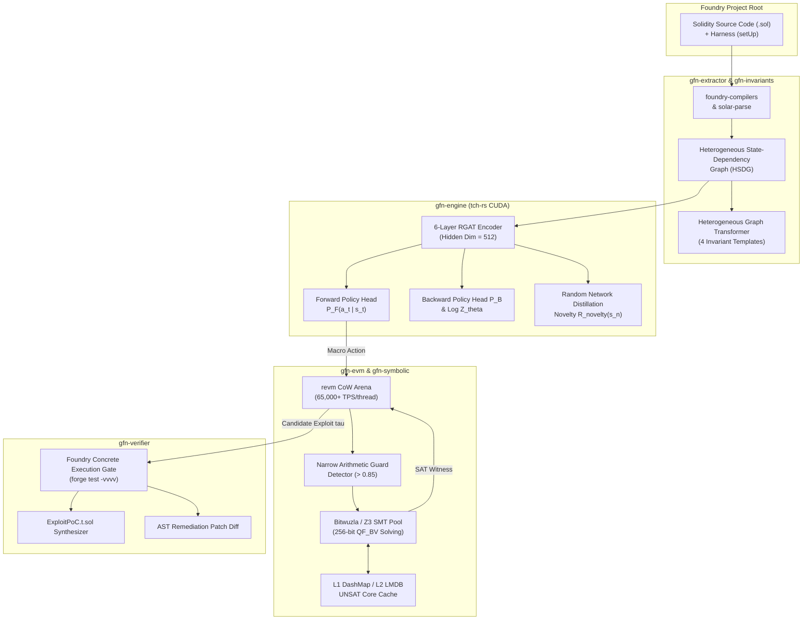
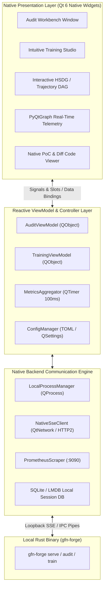
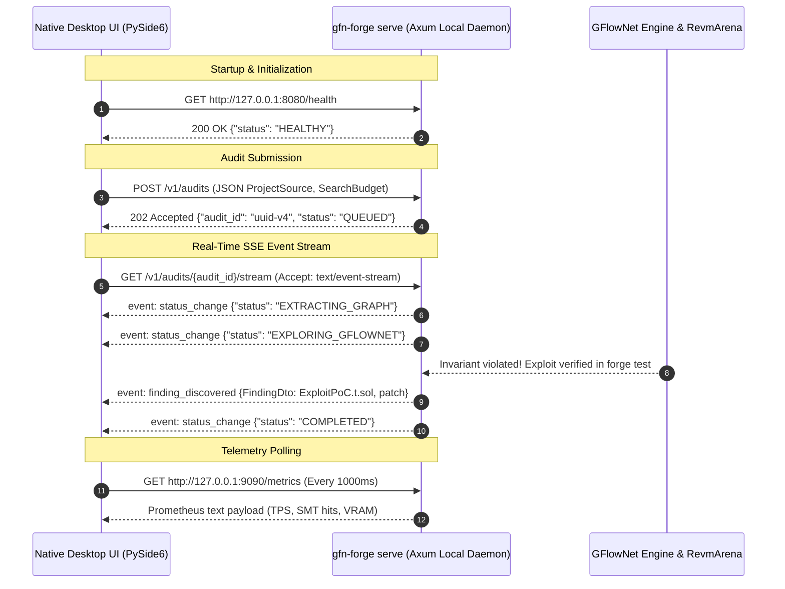

# GFlowNet-Prover: System Operation Analysis & Native Desktop UI Specification

---

## 1. Executive Summary & Purpose

**GFlowNet-Prover (Pure Rust / Foundry Edition)** is an autonomous neuro-symbolic smart contract verification engine. It eliminates false positives and overcomes combinatorial state-space explosion by combining:
1. **Generative Flow Networks (GFlowNets)** parameterized by a Relational Graph Attention Network (RGAT) in `tch-rs` (LibTorch CUDA).
2. **In-Memory EVM Execution** via a Copy-on-Write (CoW) state arena using `revm` capable of $\ge 65,000\text{ TPS/thread}$.
3. **Micro-Step Concolic & SMT Solving** using `bitwuzla-sys` and `z3` over 256-bit BitVectors (`QF_BV` / `QF_ABV`).
4. **Concrete Foundry Verification** via `foundry-evm` and `forge test`, ensuring an uncompromised **0.0% False Positive Rate (FPR)**.

To operationalize this system for security auditors, smart contract engineers, and machine learning researchers, this document provides:
1. **A full architectural analysis** of the entire system's operations, data flow, mathematical objectives, and CLI/API surfaces.
2. **A formal software specification** for building a **native, locally-run desktop User Interface (UI)** (avoiding web-based bloat, electron memory overhead, or remote web dependencies) featuring an **intuitive multi-phase training studio** and a **comprehensive real-time audit workbench**.

---

## 2. End-to-End System Operation Analysis

### 2.1 Workspace Crate Topology & Responsibilities

The system is organized into a modular workspace (`rustc 1.82.0`, Edition 2021):

```
crates/
├── gfn-common/      # Shared domain schemas (TrajectoryRecord, Finding, AstNode, Error types)
├── gfn-extractor/   # Foundry compiler invocation, AST parsing (solar-parse), SSA CFG lifter, HSDG builder
├── gfn-invariants/  # Heterogeneous Graph Transformer (HGT), candidate template classification & compilation
├── gfn-evm/         # In-memory revm arena, cheatcodes (vm.warp/vm.roll), storage & call trace inspector
├── gfn-symbolic/    # Concolic EVM, QF_BV translation, Bitwuzla/Z3 SMT solver pool, L1/L2 UNSAT cache
├── gfn-engine/      # 6-layer RGAT encoder, autoregressive policy heads (PF, PB, LogZ), RND curiosity, TB loss
├── gfn-verifier/    # Concrete Foundry test gate (forge test), ExploitPoC.t.sol & remediation patch generator
├── gfn-monitor/     # Graph structural drift (MMD, PSI), concept drift, policy entropy, Prometheus telemetry
└── gfn-cli/         # gfn-forge CLI binary & Axum HTTP/SSE server with dynamic 2.0ms micro-batching
```



---

### 2.2 Neuro-Symbolic Mathematical Formulation & Training Objectives

The system operates across three distinct machine learning training phases:

#### Phase 1: Self-Supervised Masked State-Transition Modeling (MSTM)
- **Objective**: Learn generalized semantic representations of contract state mutations prior to observing vulnerabilities.
- **Mechanism**: Randomly masks $30\%$ of mutated storage slot targets in state transitions $(s_t, a_t) \to s_{t+1}$.
- **Loss**:
  $$\mathcal{L}_{MSTM} = \mathcal{L}_{BCE}(\hat{y}_{\text{mutated}}, y) + \mathcal{L}_{CE}(\hat{y}_{\text{dir}}, y_{\text{dir}}) + \mathcal{L}_{\text{Huber}}(\hat{\phi}_{\Delta}, \phi_{\Delta})$$

#### Phase 2: Curriculum Trajectory Balance (TB) Training
- **Objective**: Learn a forward policy $P_F(a_t \mid s_t; \theta)$ sampling multi-step exploit trajectories $\tau$ with probability proportional to reward $R(s_n)$.
- **Composite Reward**:
  $$R(s_n) = \max\left(R_{\min}, \left( \alpha \cdot R_{\text{boundary}}(s_n) + \beta \cdot R_{\text{novelty}}(s_n) + \gamma \cdot R_{\text{exploit}}(s_n) \right) \times M_{\text{unsat}}(\tau)\right)$$
  - $R_{\text{boundary}}(s_n) = \max_m \exp\left( -5.0 \cdot \frac{\max(0, U_m - L_m)}{|U_m| + 1.0} \right)$
  - $R_{\text{novelty}}(s_n)$: Normalized Welford variance of RND predictor error $\| \hat{f}_{\phi}(s_n) - f_{\text{target}}(s_n) \|_2^2$
  - $R_{\text{exploit}}(s_n) \in \{0.0, 1.0\}$: Triggered upon concrete invariant violation.
  - $M_{\text{unsat}}(\tau) \in \{10^{-3}, 0.5, 1.0\}$: Harsh penalty for unsatisfiable symbolic branches.
- **Huber-Clipped Trajectory Balance Loss**:
  $$\Delta_{TB}(\tau) = \log Z_\theta(s_0) + \sum_{t=0}^{n-1} \log P_F(s_{t+1} \mid s_t) - \log R(s_n) - \sum_{t=1}^n \log P_B(s_{t-1} \mid s_t)$$
  $$\mathcal{L}_{TB}(\tau) = \begin{cases} \frac{1}{2} (\Delta_{TB}(\tau))^2 & \text{if } |\Delta_{TB}| \le 10.0 \\ 10.0 \cdot (|\Delta_{TB}| - 5.0) & \text{otherwise} \end{cases}$$

#### Phase 3: Continual Learning with Elastic Weight Consolidation (EWC)
- **Objective**: Continually incorporate new DeFi protocols and Solidity compiler versions without catastrophic forgetting.
- **Loss**:
  $$\mathcal{L}_{\text{total}}(\theta) = \mathcal{L}_{TB}(\tau; \theta) + \frac{\lambda_{\text{EWC}}}{2} \sum_i F_i (\theta_i - \theta_i^*)^2, \quad \lambda_{\text{EWC}} = 400.0$$
  where $F_i$ is the diagonal Fisher Information Matrix of the anchor checkpoint.

---

### 2.3 Real-Time Serving, Telemetry & IPC Surfaces

The engine binary `gfn-forge` offers two modes of interaction for a UI:
1. **Direct Process CLI Invocation**: Invoking subcommands (`audit`, `pretrain`, `train`, `train-continual`) with structured stdout/stderr streaming and JSON/SafeTensors artifacts.
2. **High-Performance Local Daemon (`gfn-forge serve`)**:
   - HTTP/REST & Server-Sent Events (SSE) on `127.0.0.1:8080`.
   - Prometheus Telemetry Exporter on `127.0.0.1:9090/metrics`.
   - Dynamic $2.0\text{ ms}$ micro-batching policy inference endpoint `/v1/policy/sample-step`.
   - Continuous SSE event stream: `GET /v1/audits/:id/stream` delivering real-time status transitions, trajectory steps, synthesized invariants, and verified findings.

---

## 3. Native Desktop UI Architecture

### 3.1 Technology Stack Rationale

To satisfy the user constraint (**"a native, locally-run application rather than a web-based interface"**):
- **Web-based architectures (Electron, NW.js, web browsers) are strictly avoided** due to Chromium runtime bloat, high baseline RAM usage (500MB+), and loose OS integration.
- **Primary Recommended Native Stack**: **PySide6 / Qt 6 (C++ / Python Native Desktop)** or **Rust Native GUI (Slint / Iced / egui)**.

| Criteria | **PySide6 / Qt 6 (Recommended Primary)** | **Slint / Iced (Pure Rust Native)** | **Web/Electron (Rejected)** |
| :--- | :--- | :--- | :--- |
| **Native Execution** | 100% Native OS widgets, QPainter, hardware-accelerated OpenGL/Vulkan | 100% Pure Rust binary, tiny footprint | WebKit/Chromium sandbox, high memory |
| **Real-Time Data Plotting** | **QCustomPlot / PyQtGraph**: Millions of points @ 60 FPS | Embedded canvas or basic charts | Chart.js/D3 via DOM/Canvas (slow on $10^5$ events) |
| **Code & Diff Editor** | Native QScintilla / QPlainTextEdit with syntax highlighters | Basic text widgets | Monaco / CodeMirror (web-based) |
| **Ecosystem & Maturity** | Industrial standard for CAD, scientific & engineering tooling | Rapidly evolving, smaller widget set | Standard web ecosystem |
| **IPC to `gfn-forge`** | Native QProcess, QLocalSocket, QtNetwork SSE/HTTP, QThreadPool | Async channels, tokio, direct crate linking | Node.js IPC, WebSocket |

> [!IMPORTANT]
> **Selected Native Framework**: **PySide6 (Qt 6.8+ Native Desktop)** with high-performance `PyQtGraph` for real-time telemetry and `QCustomPlot` / OpenGL DAG canvas. It communicates with local `gfn-forge` instances via standard input/output pipes (`QProcess`) or local loopback HTTP/SSE (`QNetworkAccessManager`). Alternatively, the architecture is specified with strict API isolation so it can be compiled directly in C++ Qt6 or Slint.

---

### 3.2 Native Application Architecture (MVVM Pattern)



---

## 4. Comprehensive UI Screen & Component Specifications

The application layout is organized around a unified, dark-themed native studio with 5 primary modes accessible via a permanent left activity bar:
1. **Auditing & Verification Workbench** (Primary user flow)
2. **Intuitive Model Training Studio** (Pre-train, Curriculum, Continual)
3. **Interactive Trajectory & State-Graph Inspector**
4. **Real-Time Telemetry & Drift Monitor**
5. **Model Registry & Release Gate Validator**

---

### 4.1 Auditing & Verification Workbench

The Workbench is the central hub where security engineers configure, launch, monitor, and triage smart contract audits.

```
+----------------------------------------------------------------------------------------------------------+
| GFlowNet-Prover [Native Foundry Edition]   - [Project: DeFi-Vault-V2]                 [-] [o] [x]         |
+---+----------------------------------------------------+-------------------------------------------------+
| A | 1. Audit Project Configuration                     | 2. Real-Time Telemetry & Progress               |
| U | Project Path: [/home/user/contracts/vault] [Browse]| Status: [EXPLORING_GFLOWNET] (Step 42,100/100K) |
| D | Setup Contract: [ExploitHarnessTest   ]            | Revm TPS: [ 74,210 TPS ]  Wall Clock: [04:12]   |
| I | Setup Function: [setUp                ]            | SMT Hits: [ 1,420 SAT / 8,110 UNSAT / 0 Timeouts] |
| T | Solc: [0.8.24]  EVM: [Cancun]  Fork: [18000000]    | Partition LogZ Estimate: [ 14.821 ]             |
|---| Trajectory Budget: [ 100,000 ]  Depth: [ 15 ]      | Progress: [=====================>--------] 42.1%|
| T | Invariant Mode: [4 Automated HGT Templates    [v]] | [ || Pause ] [ [] Stop ] [ ^ Export Findings ] |
| R |----------------------------------------------------+-------------------------------------------------|
| A | 3. Synthesized Invariants (4 Active)               | 4. Verified Findings (0.0% False Positive Gate) |
| I | [*] INV_SOLVENCY_01      | Conf: 99.4% | SAT       | [CRITICAL] FINDING-01: Vault Precision Rounding |
| N | [*] INV_MONOTONICITY_02  | Conf: 98.1% | SAT       |   Violated Invariant: INV_ROUNDING_DUST_04       |
|---| [*] INV_ACCESS_CTRL_03   | Conf: 100%  | SAT       |   Trajectory Depth: 7 Steps                      |
| M | [!] INV_ROUNDING_DUST_04 | Conf: 99.8% | VIOLATED! |   Forge Test Gate: PASS (Concrete Exploit Confirmed)|
| O |----------------------------------------------------+-------------------------------------------------|
| N | 5. Verified Foundry PoC (ExploitPoC.t.sol)         | 6. Remediation Patch Diff                       |
| I | function test_exploit_INV_ROUNDING_DUST_04() {     | --- a/src/VaultErc4626.sol                      |
| T |     vm.startPrank(ATTACKER0);                      | +++ b/src/VaultErc4626.sol                      |
| O |     vault.deposit(1 wei, ATTACKER0);           | @@ -142,4 +142,5 @@                             |
| R |     vm.warp(block.timestamp + 1 days);         | -   return assets * totalShares / totalAssets;  |
|   |     vault.redeem(1, ATTACKER0, ATTACKER0);     | +   require(totalAssets > 0, "Zero assets");    |
|   | }                                                  | +   return mulDiv(assets, totalShares, ...);    |
+---+----------------------------------------------------+-------------------------------------------------+
```

#### Detailed Widget Specifications:
1. **Target Project Panel**:
   - `QFileSystemModel` tree selector for Foundry repository roots.
   - Auto-detection of `foundry.toml`, installed `solc` compilers via `svm-rs`, and test harnesses matching `*Test.sol`.
   - Input fields for `setup_contract` and `setup_function`.
2. **Execution & Search Controls**:
   - Sliders and numeric spin boxes for `max_trajectories` (1,000 to 1,000,000), `max_depth` (2 to 25), `batch_size` (8, 16, 32, 64), and `smt_timeout_ms`.
   - Toggle switch for `enable_online_adaptation`.
   - Action buttons: "Run Local Synchronous Audit", "Submit Daemon Background Job", "Stop/Cancel".
3. **Invariant Matrix View**:
   - `QTableView` displaying synthesized invariants grouped by the 4 canonical categories:
     - *Conservation of Value & Solvency*
     - *State Machine Monotonicity*
     - *Privilege & Access Control Isolation*
     - *Rounding & Precision Neutrality*
   - Real-time indicator badges: `SYNTHESIZING` (yellow), `STABLE` (green), `VIOLATED` (flashing red).
4. **Verified Findings & PoC Viewer**:
   - Two-pane split view featuring native syntax-highlighted code editors:
     - Left pane: `ExploitPoC.t.sol` with Solidity syntax highlighting, line numbers, and a "Run in Local Foundry (`forge test`)" button.
     - Right pane: Unified Git-style diff viewer showing the synthesized minimal negated precondition remediation patch.

---

### 4.2 Intuitive Training Studio

Training a neuro-symbolic GFlowNet requires setting up complex hyperparameters, datasets, and objectives. The **Intuitive Training Studio** breaks this down into an interactive 3-step wizard and live training dashboard.

```
+----------------------------------------------------------------------------------------------------------+
| GFlowNet-Prover [Training Studio] - Mode: Phase 2 Curriculum Trajectory Balance            [-] [o] [x]   |
+---+------------------------------------------------------------------------------------------------------+
|   | [Step 1: Phase Select]  >>>  [(O) Step 2: Hyperparameters & Corpus]  >>>  [Step 3: Execution & Monitor] |
| T |------------------------------------------------------------------------------------------------------|
| R | Training Phase:  ( ) Phase 1: MSTM Pretrain   (*) Phase 2: Curriculum TB   ( ) Phase 3: Continual EWC|
| A | Preset Profiles: [Balanced DeFi Exploration [v]]  [Load TOML Config]  [Save TOML Config]             |
| I |------------------------------------------------------------------------------------------------------|
| N | [Hyperparameters Grid]                              | [Curriculum & Hardware Allocation]             |
| I | Policy LR (eta_theta):  [ 0.000300 ] (Warmup: 2000) | Training Corpus: [/data/corpus/mainnet] [Browse|
| N | Log-Z LR (eta_Z):       [ 0.005000 ] (Fast Track)   | Compute Device:  [*] GPU 0: NVIDIA RTX 4090   |
| G | Huber Delta (delta_TB): [ 10.0     ]                | Worker Threads:  [ 16 Threads (revmArena)    ] |
|   | Reward Boundary (alpha):[ 1.00     ]                | Replay Buffer:   [ 100,000 ] Prioritized PER   |
| S | Reward Novelty (beta):  [ 0.50     ] (RND Distill)  | Checkpoint Path: [checkpoints/curriculum.st]   |
| T | Reward Exploit (gamma): [ 100.0    ] (Spike)        | Continuous Validation: [*] Every 500 Steps     |
| U | SMT Handover Threshold: [ 0.85     ]                | Baseline Anchor: [checkpoints/mstm_v1.st     ] |
| D |------------------------------------------------------------------------------------------------------|
| I | [ > Launch Training Pipeline ]  [ Reset Defaults ]  [ Export Training Script CLI Command ]           |
| O |------------------------------------------------------------------------------------------------------|
|   | LIVE TRAINING TELEMETRY (Step 12,450 / 50,000 | Epoch 3/10)                                          |
|   | +----------------------------------+----------------------------------+------------------------------+
|   | | Trajectory Balance Loss (L_TB)   | Spearman Rank Correlation (rho)  | Action Policy Entropy (H_PF) |
|   | | 4.2 |                            | 1.0 |                            | 3.0 |                        |
|   | |     |   \                        |     |             _.-''''        |     | \                      |
|   | | 0.8 |    \__/\_                  | 0.8 |       _..-''  (Target >=0.82)| 1.5 |  \___/\_             |
|   | | 0.0 +------------------ [Step]   | 0.0 +------------------- [Step]  | 0.0 +---------------- [Step] |
|   | | Cur: 0.384  (Huber Clipped)      | Cur: 0.864 (PASS SLA)            | Cur: 1.42 nats (Healthy)     |
|   | +----------------------------------+----------------------------------+------------------------------+
|   | Flow Partition LogZ: [ 18.231 +/- 0.004 ] (Stationary)  | Discovered Exploit Modes: [ 14 / 16 (87.5%) ]|
+---+------------------------------------------------------------------------------------------------------+
```

#### Key Capabilities of the Training Studio:
1. **Interactive Preset Wizard**:
   - **Phase 1: MSTM Pre-training**: Set corpus directory, token masking ratio (default 30%), number of epochs, and Blake3 manifest destination.
   - **Phase 2: Curriculum Trajectory Balance**: Configure dual learning rate groups ($\eta_\theta$ vs $\eta_Z$), Huber loss threshold $\delta_{TB} = 10.0$, and multi-objective reward mixing ($\alpha, \beta, \gamma$).
   - **Phase 3: Continual Learning with EWC**: Select anchor checkpoint $\theta^*$, inspect computed Fisher diagonal weights, and tune quadratic penalty coefficient $\lambda_{\text{EWC}}$ (default 400.0).
2. **Visual Hyperparameter Presets**:
   - *Quick Smoke Test* (Small model, 1 GPU, 5K steps)
   - *Production Audit Tuning* (Full 6-layer RGAT, 16 worker threads, 100K steps)
   - *Deep Exploit Search* (High novelty weight $\beta=1.5$, temperature annealing, 500K steps)
3. **Live Real-Time Training Charts (PyQtGraph)**:
   - **Trajectory Balance Loss Curve**: Plotting moving average $\mathcal{L}_{TB}$ with Huber clipping markers.
   - **Spearman Rank Correlation ($\rho_{TB}$)**: Displays the correlation between $\log P_F(\tau)$ and $\log R(\tau)$ with a visual target line at $\rho \ge 0.82$.
   - **Policy Entropy Gauge**: Displays action distribution entropy $H(P_F)$ with automated colored indicators (Red: Mode Collapse $< 0.35$ nats; Green: Healthy Exploration $\ge 1.0$ nats).
   - **Discovered Exploit Modes Bar**: Visual cluster matrix showing distinct ground truth vulnerability archetypes uncovered.

---

### 4.3 Interactive Trajectory & State-Graph Inspector

GFlowNet constructs transactions step-by-step over an EVM state graph. The **Trajectory Inspector** allows users to scrub through sampled transaction sequences, inspect concrete storage values, and analyze symbolic SMT constraints.

```
+----------------------------------------------------------------------------------------------------------+
| GFlowNet-Prover [Trajectory & State-Graph Inspector] - Trajectory: [audit-traj-seed-42-00384]            |
+----------------------------------------------------------------------------------------------------------+
| Trajectory Overview: Steps: 4 | Reward: 100.0 | Status: EXPLOIT_CONFIRMED | Invariant: INV_SOLVENCY_01   |
| [|<] [<< Step] [Play / Scrub Timeline: Step 2 of 4] [Step >>] [>|]   Log P_F: -1.24  | Log P_B: -3.81   |
+------------------------------------+-------------------------------------+-------------------------------+
| Transaction Call Trace             | EVM State Mutation (revm CoW)       | Symbolic Guard (Bitwuzla/Z3)  |
|------------------------------------|-------------------------------------|-------------------------------|
| [Step 0] vm.warp(1 days)           | Contract: VaultErc4626              | Guard Type: Precision Branch  |
| [Step 1] ATTACKER0 -> deposit()    | Slot 0x00 (totalAssets):            | AST Node: require(shares > 0) |
|   Arg0 (assets): 1000000000000000  |   0x0000...0000 -> 0x0000...03E8    | SMT Formula (QF_BV):          |
| > [Step 2] ATTACKER0 -> inflate() <| Slot 0x01 (totalSupply):            |   (assert (bvugt              |
|   Arg0 (shares): 1                 |   0x0000...0001 -> 0x0000...0001    |     (bvmul shares totalAssets)|
| [Step 3] ATTACKER0 -> withdraw()   | Actor Balance (ATTACKER0):          |     totalShares))             |
|   Arg0 (shares): 1000000000000000  |   ETH: 99.89 -> 99.89 (-0.001 gas)  | Solver Result: SAT (42 ms)    |
|                                    |   Shares: 1 -> 1                    | Concrete Witness:             |
|                                    | Storage Novelty R_novelty: 0.941    |   shares = 0x0000...0001      |
+------------------------------------+-------------------------------------+-------------------------------+
| Heterogeneous State-Dependency Graph (HSDG Subgraph for Step 2)                                          |
|                                                                                                          |
|  [Func: deposit] ===WritesTo===> [Storage: totalAssets] <===ReadsFrom=== [Condition: shares > 0]        |
|         ^                               |                                      |                         |
|         | Calls                         | Modifies                             | Solves                  |
|  [Actor: ATTACKER0]                     v                                      v                         |
|         |                       [Storage: totalSupply] ================> [Bitwuzla SMT SAT]              |
|         v                                                                                                |
|  [Func: inflate]                                                                                         |
+----------------------------------------------------------------------------------------------------------+
```

#### Key Capabilities:
- **Timeline Scrubber**: Jump between step 0 ($s_0$) and step $n$ ($s_n$) to see how contract storage, actor balances, and environment cheatcodes evolved.
- **Storage Delta Inspector**: Highlights mutated storage slots with variable names from Foundry's `storageLayout` artifacts.
- **Symbolic Solver Debugger**: Displays the exact SMT-LIBv2 `QF_BV` constraint generated by `gfn-symbolic`, solver timing, and the concrete witness assignment.
- **Interactive HSDG Subgraph Viewer**: Hardware-accelerated interactive graph layout rendered with native OpenGL / QGraphicsView showing relations between Function nodes, Storage nodes, and Conditions.

---

### 4.4 Real-Time Telemetry & Drift Monitor

Operational reliability requires tracking structural and concept drift across Solidity versions and protocols.

```
+----------------------------------------------------------------------------------------------------------+
| GFlowNet-Prover [Operational Telemetry & Drift Monitor]                                    [-] [o] [x]   |
+----------------------------------------------------------------------------------------------------------+
| [Structural & Opcode Drift (gfn-monitor)]           | [Concept Drift & Neuro-Symbolic Alignment]         |
| MMD^2 Graph Topology Shift: [ 0.042 ] (Safe < 0.08) | Median Trajectory Balance Residual: [ 0.38 ] (OK)  |
| Population Stability Index (PSI): [ 0.091 ] (Normal)| SMT Solver Handover Efficacy:       [ 14.2% SAT ]  |
| Opcode Shift (Cancun TLOAD/TSTORE): [ +14.2% ]      | Revm-to-Forge Gate Mismatch:        [ 0.000% ] P1=0|
| Storage Slot Packing Divergence:    [ 0.038 ]       | Spearman Flow-Reward Rank (rho):    [ 0.862 ]    |
| RND Baseline Saturation (KS-Test):  [ 0.112 ]       | Action Space Entropy H(P_F):        [ 1.48 nats ]|
| Status: [ ALL DRIFT METRICS WITHIN HEALTHY BOUNDS ] | Status: [ NEURO-SYMBOLIC ALIGNMENT VERIFIED ]      |
+-----------------------------------------------------+----------------------------------------------------+
| Hardware & System Resource Gauges (Scraped from localhost:9090 every 2s)                                 |
|                                                                                                          |
| GPU VRAM: [=======>-----------------] 7.8 / 24.0 GB | CPU Cores (revm Rayon): [=============>------] 68% |
| GPU CUDA Core Utilization: [=========>------] 52.4% | LMDB Persistent Cache Size: 1.4 GB / 32.0 GB       |
| In-Memory Revm Arena TPS:  [ 74,800 TPS / Thread ]  | L1 DashMap UNSAT Cache Hit Ratio: 78.4% (Fast Path)|
+----------------------------------------------------------------------------------------------------------+
| Self-Healing Incident Diagnostic Log                                                                     |
| [20:14:02] [INFO] L1 Unsat cache hit on sha3(0x4a9b...): SmtStatus::Unsat returned in 0.008 ms.          |
| [20:15:44] [INFO] Step 2 candidate branch boundary score = 0.891 (> 0.85). Dispatched to Bitwuzla pool.  |
| [20:15:45] [INFO] Bitwuzla solver thread 2 found SAT witness in 42 ms. Concretizing calldata argument 0. |
| [20:16:11] [SUCCESS] Candidate exploit verified by forge test -vvvv gate. Zero false positive confirmed. |
+----------------------------------------------------------------------------------------------------------+
```

---

### 4.5 Model Registry & Release Gate Validator

When training or fine-tuning models, the **Model Registry** ensures only checkpoints passing all 7 Release Gates are promoted to production auditing.

```
+----------------------------------------------------------------------------------------------------------+
| GFlowNet-Prover [Model Registry & Release Gates]                                           [-] [o] [x]   |
+----------------------------------------------------------------------------------------------------------+
| Active Checkpoints:                                                                                      |
|   [*] checkpoint_curriculum_tb_v1.safetensors   [PROMOTED]   Blake3: d4f9...81e2  Size: 412 MB           |
|   [ ] checkpoint_pretrained_mstm_v1.safetensors [PRETRAIN]   Blake3: e1a0...99bb  Size: 280 MB           |
|   [ ] candidate_continual_ewc_v2.safetensors    [EVALUATING] Blake3: a8c2...03f1  Size: 412 MB           |
+----------------------------------------------------------------------------------------------------------+
| Automated Release Gate Validation Suite (Candidate: candidate_continual_ewc_v2.safetensors)              |
|                                                                                                          |
| Gate # | Gate Identifier             | Metric Target                  | Candidate Score | Gate Status    |
|--------|-----------------------------|--------------------------------|-----------------|----------------|
| Gate 1 | False Positive Rate (FPR)   | == 0.0% (Concrete Forge Gate)  | 0.0% (0 / 110)  | [PASSED] (OK)  |
| Gate 2 | Multi-Modal Exploit Recall  | >= 85.0% on MultiBug-Bench     | 88.2%           | [PASSED] (OK)  |
| Gate 3 | Deep Trajectory Depth Recall| >= 75.0% for Depth >= 5 Steps  | 78.4%           | [PASSED] (OK)  |
| Gate 4 | Spearman Correlation (rho)  | >= 0.82 Rank Correlation       | 0.854           | [PASSED] (OK)  |
| Gate 5 | Catastrophic Forgetting EWC | <= 2.0% Degradation on Anchor  | +0.4% (No Drop) | [PASSED] (OK)  |
| Gate 6 | SMT Timeout Resilience      | <= 5.0% Timeouts @ 5000ms      | 1.8%            | [PASSED] (OK)  |
| Gate 7 | Native Revm Throughput      | >= 65,000 TPS / Thread         | 73,400 TPS      | [PASSED] (OK)  |
|                                                                                                          |
| Release Certification: ALL 7 RELEASE GATES PASSED (100%). Safe to promote candidate.                     |
| [ Promote Candidate to Active Audit Policy ]  [ Rollback to Previous Checkpoint ]  [ Export Cert Report ]|
+----------------------------------------------------------------------------------------------------------+
```

---

## 5. Software Architecture & Implementation Plan

### 5.1 Project Directory Structure for the Native UI

The UI will be housed in a clean, dedicated native desktop module alongside the Rust workspace:

```
ui-desktop/
├── pyproject.toml              # Modern Python packaging (PySide6, pyqtgraph, qasync, tomli)
├── src/
│   ├── main.py                 # Application entrypoint & Qt initialization
│   ├── app.py                  # Main QMainWindow, toolbar, and routing
│   ├── config.py               # TOML configuration parser and validator
│   ├── views/                  # Native Qt Widgets and Windows
│   │   ├── audit_view.py       # Auditing & Verification Workbench
│   │   ├── training_view.py    # Intuitive Training Studio & Stepper
│   │   ├── trajectory_view.py  # Trajectory Timeline & Call Trace Inspector
│   │   ├── telemetry_view.py   # PyQtGraph Charts & Prometheus Dashboard
│   │   ├── registry_view.py    # Model Registry & Release Gates Matrix
│   │   └── widgets/
│   │       ├── code_editor.py  # Syntax-highlighted Solidity & Patch viewer
│   │       ├── dag_canvas.py   # OpenGL/QGraphicsScene HSDG Graph Visualizer
│   │       └── metric_card.py  # Real-time metric card badges
│   ├── viewmodels/             # Reactive MVVM ViewModels (QObjects)
│   │   ├── audit_vm.py         # Manages audit state transitions and findings
│   │   ├── training_vm.py      # Manages training parameters and live loss
│   │   └── telemetry_vm.py     # Aggregates telemetry data from Prometheus
│   └── services/               # IPC & Backend Communication
│       ├── process_manager.py  # Launches and monitors `gfn-forge` processes
│       ├── sse_client.py       # High-performance QtNetwork SSE listener
│       └── prom_client.py      # Prometheus endpoint reader (:9090)
└── resources/
    ├── styles/
    │   └── dark_theme.qss      # Clean, professional engineering dark theme
    └── icons/                  # High-DPI SVG iconography
```

---

### 5.2 Inter-Process Communication (IPC) Protocol

The Native UI communicates with `gfn-forge` through two robust channels:



#### SSE Event Schema Received by UI:
```json
{
  "event": "finding_discovered",
  "data": {
    "finding_id": "FINDING-PRECISION-01",
    "violated_invariant_id": "INV_ROUNDING_DUST_04",
    "severity": "CRITICAL",
    "trajectory_steps": [
      {
        "step_idx": 0,
        "caller_role": "ATTACKER0",
        "target_contract": "VaultErc4626",
        "function_signature": "deposit(uint256,address)",
        "concrete_calldata_hex": "0x6e553f650000000000000000000000000000000000000000000000000000000000000001",
        "decoded_args": ["1 wei", "0xAttacker0Address"],
        "vm_warp_sec": 86400,
        "vm_roll_blocks": 7200
      }
    ],
    "foundry_poc_solidity_code": "// SPDX-License-Identifier: MIT\npragma solidity ^0.8.24;\n...",
    "forge_test_stdout": "[PASS] test_exploit() (gas: 142091)",
    "minimal_negated_precondition": "require(assets > 0 && totalAssets > 0);",
    "remediation_patch_diff": "--- a/src/Vault.sol\n+++ b/src/Vault.sol\n..."
  }
}
```

---

### 5.3 Step-by-Step Implementation Roadmap

| Milestone | Target Deliverable | Technical Details |
| :--- | :--- | :--- |
| **Milestone 1: Core Native Shell & IPC Engine** | Process & Network Service Layer | - Implement `LocalProcessManager` for spawning `gfn-forge`.<br>- Implement `NativeSseClient` with auto-reconnection and event parsing.<br>- Create dark-mode UI skeleton with responsive sidebar navigation. |
| **Milestone 2: Audit & Verification Workbench** | Full Audit User Flow | - Build Foundry workspace selector with `svm-rs` compiler detection.<br>- Build Invariant Table with live status updating.<br>- Integrate QScintilla/syntax-highlighted PoC code viewer and diff inspector. |
| **Milestone 3: Intuitive Training Studio** | Training Wizard & Live Loss Tracking | - Multi-step wizard for MSTM, Curriculum TB, and Continual EWC.<br>- Form validation for learning rates, Huber loss, and reward mixing weights.<br>- Implement `PyQtGraph` canvas for live $\mathcal{L}_{TB}$, Spearman $\rho_{TB}$, and policy entropy $H(P_F)$. |
| **Milestone 4: Trajectory & HSDG Visualizer** | Interactive State Exploration | - Step-by-step timeline scrubber for candidate exploit trajectories.<br>- Storage delta inspector showing EVM memory and slot transitions.<br>- OpenGL/QGraphicsScene rendering of HSDG dependency graphs. |
| **Milestone 5: Telemetry, Drift & Model Registry** | Operational Monitoring & QA | - Prometheus `:9090/metrics` scraper and real-time dashboard gauges.<br>- Drift indicator alerts (MMD, PSI, SMT timeouts).<br>- Release Gate pass/fail validation table with one-click checkpoint promotion. |
| **Milestone 6: Native Packaging & Distribution** | Standalone Local Executable | - Package the UI via PyInstaller / Nuitka into a single standalone local executable.<br>- Bundle or auto-locate `gfn-forge` binary and Foundry (`forge`). |

---

## 6. Verification & Quality Assurance Protocols

1. **Native Performance Targets**:
   - UI startup time: $\le 1.2\text{ seconds}$ on standard desktop hardware.
   - Idle memory footprint: $\le 95\text{ MB}$ RAM (vs. $> 500\text{ MB}$ for Electron).
   - Telemetry rendering frame rate: Steady $\ge 60\text{ FPS}$ during peak $75,000\text{ TPS}$ revm exploration.
2. **Deterministic Reproducibility**:
   - Every audit configured in the UI saves an exact replica `audit_config.toml` capturing PRNG seed, Foundry compiler profile, and budget.
   - One-click "Copy Foundry Command" button allows instant verification in raw terminal:
     ```bash
     gfn-forge audit --project . --config configs/default_audit.toml --seed 42
     ```
3. **Fail-Safe Process Management**:
   - If the UI window is closed while a training or audit process is active, a native confirmation dialog offers to:
     - Keep the daemon running in the background.
     - Gracefully terminate with `SIGINT` (triggering an atomic SafeTensors checkpoint save).
4. **Training Studio Stability Controls & Telemetry (`TrainingStudioView`)**:
   - Step 2 exposes interactive spinboxes and toggles for **Grad Clip $\|\mathbf{g}\|_2$** (`clip_grad_norm`), **Linear Warmup Steps** (`lr_warmup_steps`), **EMA Decay $\beta_{\text{EMA}}$** (`ema_decay`), and **Cosine LR + Spike Guard** (`enable_grad_spike_guard`), serialized directly to the `[optim]`, `[tb_loss]`, and `[stability]` TOML sections.
   - The Live 60 FPS Telemetry Dashboard renders both instantaneous $\mathcal{L}_{TB}$ and the dashed orange **EMA $\mathcal{L}_{TB}$ overlay curve**, alongside a fifth KPI card (**`GRADIENT NORM ||g||_2 & GUARD`**) reporting live clipped gradient norm and stability status (`STABLE`, `WARMUP`, `GRAD_CLIPPED`, `SPIKE_DAMPED`, `NAN_GUARD`).
